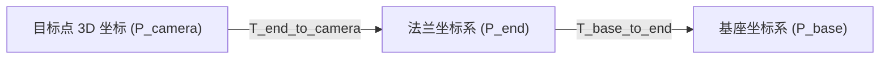

# 摄像机标定（手眼标定与内参校准）详细教程及完成步骤

本教程专为**睿尔曼 RM65-6F 协作机械臂**末端挂载 **Intel RealSense D435i 深度相机**（眼在手上 Eye-in-Hand 结构）设计，涵盖了相机内参校准、手眼标定数学原理、现场数据采集规范、自动化求解脚本运行以及 3D 重投影精度验证的完整闭环步骤。

---

## 1. 标定理论基础与坐标变换关系

在 Eye-in-Hand（眼在手上）系统架构中，深度相机固定安装在机械臂末端法兰（Flange）上。相机的 3D 测量结果是在**相机坐标系（Camera Frame）**下表达的，而机械臂控制指令是在**基座坐标系（Base Frame）**下发出的。

求解手眼标定矩阵 $T_{end \to camera}$（$4 \times 4$ 齐次变换矩阵）的目的是将相机拍摄到的 3D 目标坐标 $P_{camera}$ 转换为基座坐标系下的绝对三维坐标 $P_{base}$。



### 齐次坐标变换公式：
$$P_{base} = T_{base \to end} \cdot T_{end \to camera} \cdot P_{camera}$$

在多次变换中，通过在不动标定板前变动机械臂姿态（采集 $N \ge 15$ 组数据），满足经典的 **$A \cdot X = X \cdot B$** 手眼标定方程：
$$(T_{base \to end}^i)^{-1} \cdot T_{base \to end}^j \cdot X = X \cdot T_{target \to camera}^i \cdot (T_{target \to camera}^j)^{-1}$$
其中 $X = T_{end \to camera}$ 为待求手眼外参矩阵。

---

## 2. 准备工作

### 2.1 硬件准备
1. **机械臂与相机**：RM65-6F 机械臂（已连接上电）+ Intel RealSense D435i（已固定在机械臂末端）。
2. **标定板**：准备标准棋盘格（Chessboard）或 ChArUco 标定板：
   * **棋盘格规格**：内角点 $9 \times 6$（即横向 10 格、纵向 7 格）。
   * **单格尺寸**：方格边长精确测量（例如 $25.0\text{mm}$）。
   * **安装要求**：将标定板平整牢固地贴在机械臂工作范围内的桌面上（标定过程中**严禁移动标定板**）。

### 2.2 软件依赖
确保 Python 环境已安装 OpenCV 与 NumPy / PyYAML / SciPy（可通过 pip 安装）：
```bash
pip install opencv-python numpy scipy pyyaml pyrealsense2
# 或直接安装项目依赖：
pip install -r requirements.txt
```

---

## 3. 详细完成步骤 (Step-by-Step)

### 步骤一：创建数据采集目录
在项目根目录下创建标定数据集目录 `data/calibration_samples/`：
```bash
mkdir -p data/calibration_samples/
```

### 步骤二：多方位采集数据 (15~20 组点位)
启动相机与机械臂，控制机械臂在标定板上方不同视角进行观察。

> [!IMPORTANT]
> **采样姿态多样性原则**：
> 1. **俯仰与翻滚角变化**：姿态角（Rx, Ry, Rz）变化需足够丰富（建议倾角变化 $\ge 15^\circ \sim 30^\circ$）。
> 2. **距离变化**：包含远景（如 600mm）、中景（如 400mm）、近景（如 250mm）。
> 3. **标定板位置覆盖**：确保标定板分别出现在视野的左上、右上、中心、左下、右下区。

每次调整好姿态后，保存以下两项数据到 `data/calibration_samples/`：
* `frame_XX.png`：当前相机 Color 彩色图像。
* `pose_XX.json`：机械臂当前法兰位姿 $[x, y, z, rx, ry, rz]$（可通过 `arm.get_current_pose()` 实时获取）。

#### `pose_01.json` 数据示例：
```json
{
  "pose": [350.5, -120.3, 410.0, 3.1415, 0.052, -0.128]
}
```

---

### 步骤三：运行自动化手眼标定求解脚本
使用项目提供的求解工具 [`tools/calibrate_hand_eye.py`](file:///home/unitree/zonann/arm_project/tools/calibrate_hand_eye.py) 进行求解（对齐 [睿尔曼官方手眼标定指南](https://develop.realman-robotics.com/AI/developerGuide/hand/)）：

```bash
# 离线求解（指定标定板参数：内角点 11x8，单格 30.0mm）
python tools/calibrate_hand_eye.py --data-dir data/calibration_samples --pattern-width 11 --pattern-height 8 --square-size 30.0

# 或带实时交互采集（支持 GUI 弹窗或 --headless 远程无头终端模式）
python tools/calibrate_hand_eye.py --collect --data-dir data/calibration_samples
```

脚本将自动执行：
1. 提取每张图像的棋盘格角点（`cv2.findChessboardCorners` + `cornerSubPix` 亚像素精细化）。
2. 使用 `cv2.calibrateCamera` 标定真实相机内参 ($mtx, dist$) 并精确解算标定板在相机坐标系下的外参 ($rvecs, tvecs$)。
3. 将机械臂末端位姿数据采用 Z-Y-X 欧拉角转化为末端相对于基座的旋转矩阵 $R_{tool}$ 与平移向量 $t_{tool}$，并执行位姿旋转充分度检查（验证各轴旋转是否 $\ge 30^\circ$）。
4. 运行 `cv2.calibrateHandEye` 求解 $T_{camera \to end}$（默认使用 `CALIB_HAND_EYE_TSAI` 算法）。
5. 计算基座坐标系下标定板位置一致性标准差与空间重投影最大偏差。
6. 将标定结果（$T_{end\_to\_camera}$、外参旋转矩阵、平移向量、相机内参等）自动写回全局配置文件 [`config/settings.yaml`](file:///home/unitree/zonann/arm_project/config/settings.yaml)。

#### 计算输出示例：
```text
==================================================
🎉 睿尔曼 RM65 手眼标定 (Eye-in-Hand) 求解成功！
平移向量 translation_vector (mm): [45.2104, -32.1023, 120.5512]
旋转矩阵 rotation_matrix:
[[ 0.9998 -0.0121  0.0154]
 [ 0.0123  0.9997 -0.0182]
 [-0.0152  0.0184  0.9997]]
4x4 齐次矩阵 T_camera_to_end (P_end = T * P_cam):
[[ 0.9998 -0.0121  0.0154  45.2104]
 [ 0.0123  0.9997 -0.0182 -32.1023]
 [-0.0152  0.0184  0.9997 120.5512]
 [ 0.      0.      0.       1.    ]]
--------------------------------------------------
标定精度自检报告:
  • 相机标定 RMS 误差: 0.452 px
  • 标定板基座位置标准差: X=0.82mm, Y=0.61mm, Z=0.74mm
  • 空间三维一致性最大偏差: 1.54mm (官方标准推荐 < 10.0mm)
==================================================
✅ 标定结果与内参已同步持久化到: config/settings.yaml
```

---

### 步骤四：三维精度验证 (Verification)

> [!TIP]
> **3D 物理触碰校验法**：
> 1. 在标定板上选定一个已知固定特征点（如棋盘格第 (0,0) 角点 $P_{target}$）。
> 2. 保持标定板不动，将机械臂移动到视角 A，通过相机识别计算出该角点在 Base 坐标系下的位置 $P_{base}^A$。
> 3. 将机械臂移动到另一个视角 B，再次计算 $P_{base}^B$。
> 4. 计算欧氏距离误差：$e = \| P_{base}^A - P_{base}^B \|$。
> 5. **合格标准**：若三维位置误差 $e < 3.0\text{mm}$，说明手眼标定精度完全符合工业级线缆巡检与抓取需求。

---

## 4. 故障排查与常见问题

1. **角点识别失败 (`Chessboard Not Found`)**：
   * 检查光照是否过于昏暗或存在强光反光。
   * 检查棋盘格边缘是否有遮挡，建议在标定板周围留出至少 1 个方格宽度的白边。
2. **标定误差偏大（$> 5\text{mm}$）**：
   * 检查采集点位的旋转角度变化是否过小（需增加姿态倾角变化）。
   * 检查机械臂返回的姿态单位（是弧度 rad 还是角度 deg），`HandEyeCalibrator` 默认接受 rad。
   * 确认 RealSense 相机镜头已清洁且内参无剧烈畸变。
