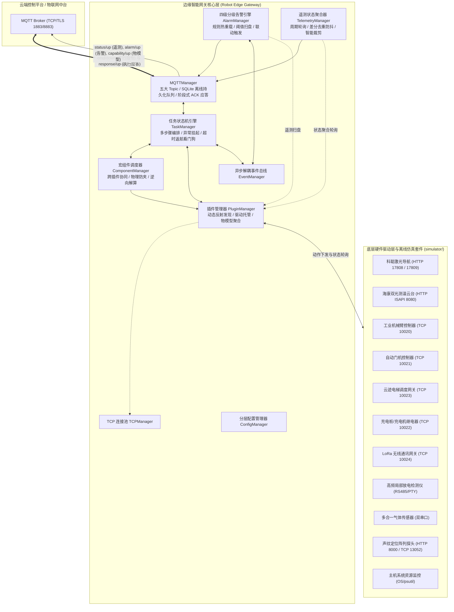

# 🤖 工业机器人边缘智能网关系统 (Robot Edge Gateway)

> 面向复杂工业巡检与特种作业机器人的边缘核心智能中枢，向上打通云端物联网平台 MQTT 全双工指令与标准化物模型交互，向下纳管导航定位、双光测温云台、工业机械臂、多合一气体分析仪与超声声纹等多元异构传感器及自动化机构，具备离线多步骤任务编排、确定性状态机、高可用断网持久化、RTH 逆向安全返航解算与四级告警联动保护。

<p align="center">
  
  
  
  
  
  
</p>

---

## 🌟 核心特性 (Features)

- **🧩 插件化与驱动解耦底座 (Plugin-Driven Architecture)**
  - 核心底座与底层硬件驱动严格解耦，全面纳管 12 类异构外设与功能插件；支持运行时动态反射发现扫描、生命周期托管、统一动作调度与物模型自省上报。
- **⚙️ 跨插件复合宏业务流水线组件 (Macro Components)**
  - 封装自动门穿行 (`DoorComponent`)、云迹乘梯上下楼 (`ElevatorComponent`)、充电桩进出对接 (`StationComponent`) 等复杂跨硬件协同业务流；具备子状态机管理、门框防夹车回滚保护与任务打断反向推演 (`RTH`) 逆向参数解算。
- **🔄 确定性任务状态机与编排引擎 (Deterministic State Machine Engine)**
  - 支持离线预设任务链原子落盘保存 (`save`) 与调度执行 (`run`)，严格杜绝临时动态任务丢失；具备毫秒级响应的任务挂起 (`pause`)、断点重试与恢复 (`resume`)、强行打断 (`abort`)，以及任务故障时自动挂起和超时自动返航保护。
- **💾 高可用断网持久化与离线重发机制 (Offline Persistence & Auto-Resend)**
  - 内置基于 SQLite 的本地磁盘队列 (`DiskQueue`)，在网络抖动或断网期间对关键控制 ACK 与设备告警消息进行持久化入库，网络恢复后常驻后台以 0.5s 匀速逐条可靠重发。
- **🚨 动态阈值判定与四级告警联动引擎 (4-Tier Alarm Engine)**
  - **分级阈值扫盘**：严格划分 `info` 提示、`warning` 警告、`error` 严重、`fatal` 致命 4 级告警；支持针对遥测指标（声压 SPL、局放 PEAK、温度、气体浓度）的动态阈值匹配，支持配置文件修改时间 (`mtime`) 毫秒级热重载；
  - **事件联动闭环**：支持配置 `auto_action` 自动化联动规则，当发生严重故障时通过异步解耦事件总线（`EventManager`）自动触发打断或安全应急动作。
- **📡 智能差分遥测聚合与去重防抖 (Smart Telemetry Pruning)**
  - 周期采集机器人物模型与各硬件传感器状态，内置智能去重与差分裁剪机制，仅在上报数值发生有效跃迁时向云端推送，大幅节约工业现场弱网与无线信道带宽。
- **⚡ 离线闭环硬件模拟器套件 (Mock Simulators)**
  - 内置覆盖全部 10 大硬件外设的仿真模拟套件（涵盖 TCP Socket、HTTP ISAPI/REST、POSIX PTY 虚拟串口），支持无实体机器人的 100% 离线脱机调试与自动化单测。

---

## 🛠️ 技术栈 (Tech Stack)

- **核心语言与环境**：Python 3.10（由 `pyproject.toml` 严格指定 `==3.10.*`），PDM（现代包依赖锁定与虚拟环境管理）
- **通信与传输协议**：
  - **云端物模型通信**：MQTT（基于 `paho-mqtt` v2，五大主题全景架构，支持 `ACK_RECEIVE` / `ACK_PROGRESS` / `ACK_EXECUTE` 阶段化应答）
  - **设备级通信总线**：工业级 TCP Socket（连接池复用与断线重连守护）、HTTP/RESTful WebAPI、Modbus RTU / 虚拟串口通讯 (POSIX PTY)
- **多媒体与机器视觉**：OpenCV、PyAV / FFmpeg（音视频软硬解码与 RTSP 视频流处理）、NumPy
- **存储与配置中心**：
  - **存储引擎**：SQLite3（离线重发消息持久化队列数据库 `mqtt_offline.db`、离线任务缓存 `tasks/*.json`）
  - **配置体系**：PyYAML（分层配置管理、热感知重载）、JSON Schema（物模型能力元数据规范）
- **质量保障与测试**：pytest、pytest-mock、pytest-cov（全量覆盖 core、plugins 与 components 模块）

---

## 🏗️ 系统架构 (Architecture)



---

## 📂 目录结构 (Project Structure)

```text
robot_project/
├── 1_setup_env.sh              # 环境检测、国内源加速与依赖一键安装脚本 (支持 --force)
├── 2_install_service.sh        # systemd 系统自启服务一键部署与 sudoers 授权脚本
├── uninstall_service.sh        # systemd 系统自启服务一键卸载脚本
├── main.py                     # 网关主程序入口 (生命周期组装、事件总线与优雅停机管理)
├── pyproject.toml              # PDM 项目构建与依赖声明 (锁定 Python 3.10)
├── pdm.lock                    # 依赖精确版本锁定文件
├── README.md                   # 项目综合工程说明文档
│
├── core/                       # 核心基础设施与管理中枢
│   ├── mqtt_manager.py         # MQTT 通信管理器 (五大 Topic、两阶段 ACK、SQLite 离线重发)
│   ├── task_manager.py         # 任务调度与状态机引擎 (步骤流水线、挂起/重试/取消、自动返航)
│   ├── plugin_manager.py       # 能力插件扫描器 (动态反射发现、生命周期与打断广播)
│   ├── component_manager.py    # 业务宏组件调度器 (复杂场景协同、全新实例隔离)
│   ├── alarm_manager.py        # 四级分级告警引擎 (传感器阈值扫盘、mtime热重载、auto_action联动)
│   ├── event_manager.py        # 异步解耦事件总线 (发布/订阅事件广播机制)
│   ├── reverse_manager.py      # RTH 返航逆向动作解析器 (两阶段返航链生成)
│   ├── telemetry_manager.py    # 遥测数据采集器 (周期状态聚合、防抖推送与差分裁剪)
│   ├── tcp_manager.py          # 工业级 TCP Socket 连接池 (连接复用与线程安全锁)
│   ├── config_manager.py       # YAML 分层配置管理器 (全局/插件配置解析与挂载)
│   ├── logger_manager.py       # 统一结构化日志管理器 (分级着色、每天午夜自动切割、30天轮转)
│   ├── context_manager.py      # 共享上下文状态存储 (跨模块零延迟状态读取)
│   └── task_storage_manager.py # 本地离线任务链持久化存储管理
│
├── plugins/                    # 12 类原子硬件驱动与功能插件
│   ├── base.py                 # 插件抽象基类 (BasePlugin 标准契约接口)
│   ├── navigation/             # 机器人激光导航插件 (科聪 MRC WebAPI 驱动与主动状态推送)
│   ├── arm/                    # 工业机械臂插件 (TCP 指令集与到位校验)
│   ├── camera/                 # 双光云台摄像头插件 (海康 ISAPI Digest 鉴权 / PTZ / 工业测温)
│   ├── record/                 # 视频录像与云端同步插件 (多路 RTSP fMP4 切片录制 / SeaweedFS 上云即焚)
│   ├── gas/                    # 六合一气体传感器插件 (Modbus RTU 双串口 / 多通道采集)
│   ├── acoustic/               # 声纹定位分析插件 (HTTP 阈值配置 / TCP 音频频谱流解析)
│   ├── gdpd/                   # 高频局部放电检测插件 (串口 Modbus 驱动 / 脉冲峰值检测)
│   ├── door/                   # 自动开门机插件 (TCP Socket 控制与开到位/关到位轮询)
│   ├── elevator/               # 云迹梯控插件 (TCP 梯控调度与轿厢楼层广播)
│   ├── station/                # 智能充电桩基站插件 (TCP 继电器控制与进出状态检测)
│   ├── lora/                   # LoRa 无线通讯网关插件 (TCP 广播监听与离线延时上报)
│   └── system/                 # 边缘主机系统健康插件 (CPU / 内存 / 磁盘 / 电池状态采样)
│
├── components/                 # 3 大跨插件业务流水线宏组件
│   ├── base_component.py       # 宏组件抽象基类 (BaseComponent 标准契约)
│   ├── config.yaml             # 业务宏组件启停配置 (按需加载控制)
│   ├── door_component.py       # 开门穿行组件 (导航到门前 -> 触发开门 -> 保持常开 -> 穿门 -> 关门闭环)
│   ├── elevator_component.py   # 云迹乘梯组件 (导航到梯前 -> 呼梯 -> 进梯 -> 选层换楼 -> 出梯)
│   └── station_component.py    # 充电桩进出对接组件 (导航到站外 -> 门开启 -> 倒车入桩 -> 继电器吸合充电)
│
├── simulator/                  # 离线闭环硬件模拟器套件 (Mock Simulators)
│   ├── start_all_simulators.py # 全量硬件模拟器一键集中启动控制脚本
│   ├── armSimulator.py         # 机械臂模拟器 (TCP 10020)
│   ├── doorSimulator.py        # 开门机模拟器 (TCP 10021)
│   ├── gasSimulator.py         # 气体检测模拟器 (双虚拟串口 /tmp/tty_gas_sim0 & sim1)
│   ├── stationSimulator.py     # 充电桩模拟器 (TCP 10022)
│   ├── elevatorSimulator.py    # 梯控系统模拟器 (TCP 10023)
│   ├── loraSimulator.py        # LoRa 网关模拟器 (TCP 10024)
│   ├── gdpdSimulator.py        # 局放检测模拟器 (虚拟串口 /tmp/tty_gdpd_sim)
│   ├── navSimulator.py         # 激光导航模拟器 (HTTP 17808)
│   ├── cameraSimulator.py      # 双光摄像头模拟器 (HTTP 8080 ISAPI Digest)
│   └── acousticSimulator.py    # 声纹定位探头模拟器 (HTTP 8000 / TCP 13052)
│
├── configs/                    # 静态系统与全局配置文件中心
│   ├── config.yaml             # 全局核心配置 (MQTT Broker、场站标识、心跳周期、日志级别)
│   ├── alarm_config.yaml       # 系统级任务异常事件告警规则 (支持 mtime 热重载)
│   └── reverse_rules.yaml      # 原子插件反向返航动作白名单映射表
│
├── data/                       # 运行时持久化数据存储目录
│   ├── mqtt_offline.db         # SQLite 断网离线消息缓存数据库
│   ├── tasks/                  # 运行时离线任务链持久化存储
│   └── plugins/                # 动态持久化传感器分级告警阈值 JSON (热生效)
│
├── tests/                      # pytest 自动化测试套件
│   ├── test_core/              # 核心基础设施单元测试
│   ├── test_components/        # 宏业务组件集成测试
│   ├── test_plugins/           # 12 大功能插件闭环测试
│   └── test_utils/             # 工具函数单元测试
│
└── docs/                       # 生产技术规范与通信协议文档中心
    ├── mqtt_cmd_down.md        # 下行控制指令协议、全量动作字典与阶段式应答规范
    ├── mqtt_status_up.md       # 周期状态与遥测数据聚合上报规范 (含差分裁剪)
    ├── mqtt_alarm_up.md        # 四级故障告警上报字典与全局安全联动规范
    ├── mqtt_capability_up.md   # 物模型能力集自省上报规范 (含 config_metrics 告警指标)
    ├── mqtt_config_down.md     # 云端配置下发协议与分级阈值热重载机制
    ├── dev_plugin_guide.md     # 插件与宏组件开发 SDK 指南 (生命周期、两阶段打断与测试规范)
    └── ops_deployment_guide.md # 生产环境部署与 Systemd 开机守护运维 SOP
```

---

## 🚀 快速上手 (Quick Start)

### 1. 环境准备 (Prerequisites)

系统开发与运行要求：
- **操作系统**：Ubuntu 20.04 LTS / 22.04 LTS (x86_64 或 aarch64 如 Jetson / RK3588)
- **Python 运行时**：**严格要求 `Python == 3.10.*`**
- **包管理工具**：[PDM](https://pdm-project.org/)
- **系统基础依赖**：
  ```bash
  sudo apt update && sudo apt install -y \
    python3.10 python3.10-venv python3.10-dev python3-pip \
    sqlite3 curl git net-tools socat \
    libgl1 libglib2.0-0 libsm6 libxext6 libxrender-dev
  
  # 赋予当前用户操作硬件串口免 root 权限
  sudo usermod -aG dialout $USER
  ```

### 2. 一键自动化部署 (Recommended)

项目提供了生产就绪的自动化安装与服务编排脚本，推荐优先使用脚本完成部署：

#### 步骤 1：环境检测与依赖极速拉取
```bash
# 赋予脚本执行权限并运行
chmod +x 1_setup_env.sh 2_install_service.sh uninstall_service.sh
./1_setup_env.sh

# 提示：若需忽略本地缓存强制全量重新同步依赖，可附加 --force 参数：
# ./1_setup_env.sh --force
```
> **`1_setup_env.sh` 自动化职责**：
> 1. 自动探测系统 Python 3.10+ 环境与 pip 工具；
> 2. 自动安装 PDM 并配置国内清华镜像源加速；
> 3. 智能检测本地 `.venv` 虚拟环境与核心依赖完整性（已就绪则秒级跳过）；
> 4. 执行 `pdm install --dev` 并对 9 大核心依赖模块与 FFmpeg 二进制库执行导入健康自检。

#### 步骤 2：一键注册并启动 systemd 系统守护服务
```bash
# 使用 sudo 提权执行系统服务安装
sudo ./2_install_service.sh
```
> **`2_install_service.sh` 自动化职责**：
> 1. 自动提取当前非 root 运行用户，修复 `data/` 与 `logs/` 属主，防止数据权限污染；
> 2. 自动检查虚拟环境完整性（缺失时自动联动拉起 `1_setup_env.sh`）；
> 3. 自动向 `/etc/sudoers.d/robot-gateway` 写入精细化免密提权白名单（支持平台远程调用 `SystemPlugin` 自愈重启网关与系统）；
> 4. 自动生成 `/etc/systemd/system/robot-gateway.service` 单元文件，配置崩溃自动拉起与优雅停机；
> 5. 自动重载 systemd、开启开机自启并立即启动服务。

#### 常用服务管理与卸载命令
```bash
# 查看服务运行状态
systemctl status robot-gateway

# 跟踪查看服务实时运行日志
journalctl -u robot-gateway -f -n 50

# 重启 / 停止服务
sudo systemctl restart robot-gateway
sudo systemctl stop robot-gateway

# 一键完全卸载 systemd 服务 (安全保留项目源码、.venv 虚拟环境与业务数据)
sudo ./uninstall_service.sh
```

---

### 3. 手动安装与依赖同步 (Manual Installation)

若仅进行本地代码开发调试或需手动控制安装细节：

```bash
# 1. 安装 PDM 工具
pip3 install --user pdm
export PATH=$HOME/.local/bin:$PATH

# 2. 绑定 Python 3.10 解释器并安装工程依赖
cd /opt/robot_project
pdm use -f python3.10

# 生产环境安装：
pdm install --prod

# 开发/测试环境安装全量依赖 (含 pytest)：
pdm install -G dev
```

---

### 4. 配置说明 (Configuration)

网关采用**分层解耦的配置架构**：

1. **全局主配置 (`configs/config.yaml`)**：
   ```yaml
   gateway:
     version: "0.1.0"
     location: "xian_lab"          # 场站标识
     auto_rth_timeout_sec: 300     # 任务挂起超时自动返航时间(秒)
     max_rth_deviation_m: 1.0      # 任务起步距离偏差阈值(米)

   mqtt:
     broker_ip: "192.168.3.36"     # MQTT 代理服务器 IP
     port: 1883
     robot_id: "P2026083101"       # 机器人全局唯一标识 (决定 Topic 命名空间)
     client_id: "Dog_Gateway"
     username: "robot2"
     password: "CHANGE_ME"
     heartbeat_interval: 5.0       # 状态遥测上报周期 (秒)

   log_level: "DEBUG"
   ```
2. **任务与系统告警配置 (`configs/alarm_config.yaml`)**：定义任务失败、挂起、恢复与取消的告警级别、抑制防抖时长与上报模板（支持 `mtime` 动态热感知生效）。
3. **返航逆向白名单 (`configs/reverse_rules.yaml`)**：定义异常撤退或取消时，机械臂、云台等原子插件的反向安全复位规则。
4. **各插件独立配置 (`plugins/<plugin_dir>/config.yaml`)**：配置各个具体硬件的 IP、端口、波特率与使能状态。

### 5. 运行服务与脱机仿真调试 (Running & Simulation)

在无实际硬件外设的开发与集成验证环境下，可使用内置全量模拟器套件进行脱机全链路闭环仿真：

```bash
# 终端 1: 一键拉起全部 10 大硬件离线模拟服务 (TCP / HTTP / 虚拟串口)
pdm run python simulator/start_all_simulators.py

# 终端 2: 启动边缘机器人网关主程序
pdm run python main.py
```

### 6. 自动化测试 (Testing)

执行全量单元测试与集成测试验证：

```bash
# 运行全量测试套件并输出详细结果
pdm run pytest tests/ -v

# 运行特定模块测试 (例如硬件插件测试)
pdm run pytest tests/test_plugins/ -v
```

---

## 📚 生产技术文档索引 (Documentation Index)

项目内置了详尽的工业级标准通信协议规范与实施维护手册，位于 `docs/` 目录下：

| 文档名称 | 说明链接 | 核心内容覆盖 |
| :--- | :--- | :--- |
| **MQTT 下行控制协议** | [mqtt_cmd_down.md](docs/mqtt_cmd_down.md) | 平台控制指令格式、全量插件动作参数约束、Code 状态码表与两阶段 ACK 应答机制 |
| **MQTT 实时状态上报** | [mqtt_status_up.md](docs/mqtt_status_up.md) | 物模型实时状态上报、11 类外设真实遥测结构解析与智能差分去重裁剪规范 |
| **MQTT 故障告警上报** | [mqtt_alarm_up.md](docs/mqtt_alarm_up.md) | 四级分级告警划分规范（info/warning/error/fatal）、错误码字典与全局安全联动时序 |
| **MQTT 物模型能力上报** | [mqtt_capability_up.md](docs/mqtt_capability_up.md) | 开机自动发现插件与宏组件能力字典，动态生成并推送 capability 数据与指标告警定义 |
| **MQTT 配置主动下发** | [mqtt_config_down.md](docs/mqtt_config_down.md) | 远程分级告警阈值配置下发协议、本地 JSON 持久化与文件 mtime 热重载机制 |
| **插件与组件开发指南** | [dev_plugin_guide.md](docs/dev_plugin_guide.md) | 基于 `BasePlugin` 与 `BaseComponent` 的标准化开发、两阶段打断与单元测试编写 SOP |
| **生产部署与运维手册** | [ops_deployment_guide.md](docs/ops_deployment_guide.md) | Linux 边缘机开机自启 Systemd 配置、日志午夜轮转归档机制与现场常见故障排障速查 |

---

## 📄 许可证 (License)

本项目采用 [MIT License](LICENSE) 开源许可证。
