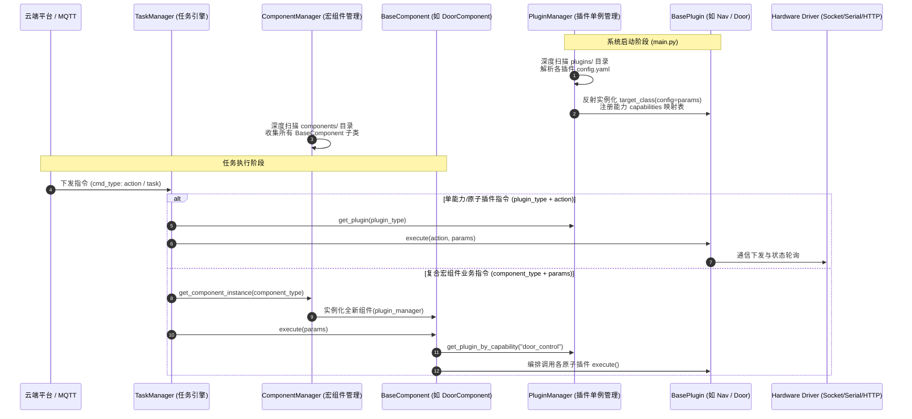
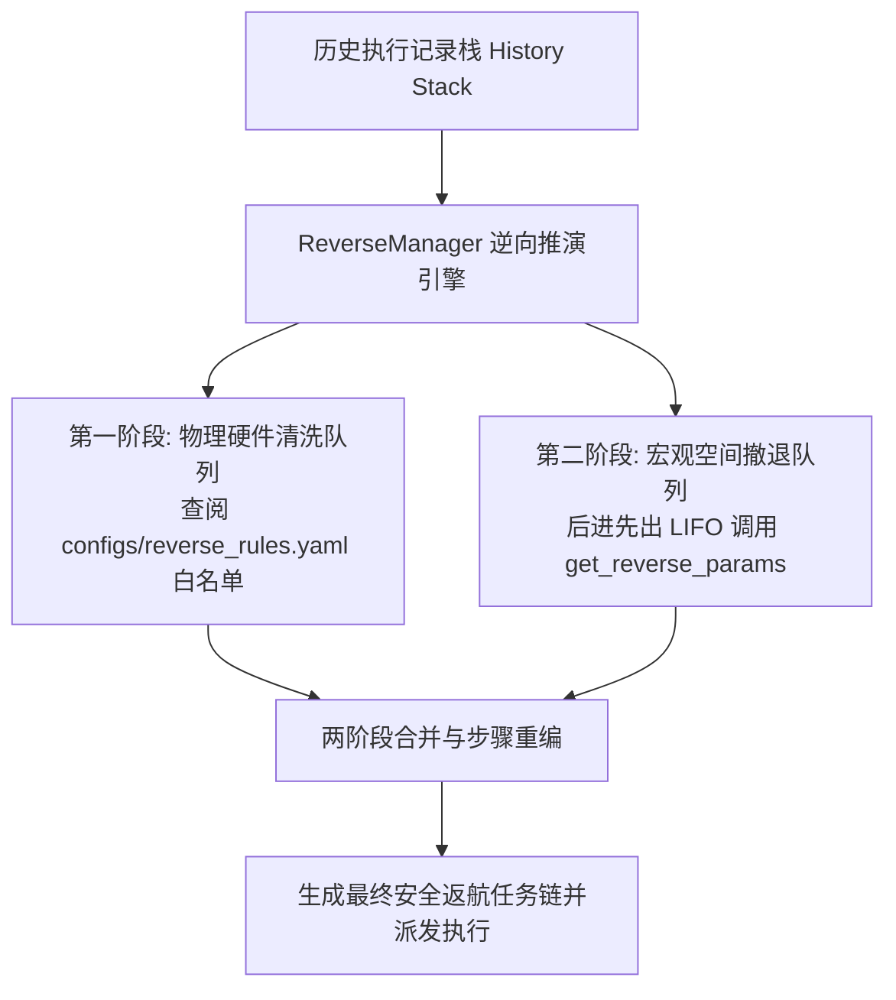

# 🧩 自定义能力插件与宏组件开发 SDK 指南 (Plugin & Component SDK)

本系统面向工业与特种巡检机器人场景，采用高度解耦的 **动态反射加载与能力契约体系**。系统自动扫描并加载两类核心业务单元：
1. **原子硬件插件 (`plugins/`)**：封装单类传感器或物理控制器的底层通信驱动，继承并实现 `BasePlugin`，由 `PluginManager` 单例托管；
2. **复合宏组件 (`components/`)**：跨多个原子插件协同编排的复杂业务流（如自动过门、乘梯换层、对桩充电），继承并实现 `BaseComponent`，由 `ComponentManager` 负责生命周期调度。

---

## 1. 架构总览与生命周期

### 1.1 系统架构与调用时序



### 1.2 动态加载机制对比

| 维度 | 原子能力插件 (`BasePlugin`) | 复合宏组件 (`BaseComponent`) |
| :--- | :--- | :--- |
| **所在目录** | `plugins/<plugin_dir>/` | `components/<name>_component.py` |
| **配置依据** | 目录内必须包含 `config.yaml` | 无需独立 yaml，由代码类定义 |
| **管理容器** | `PluginManager` (全局单例存储) | `ComponentManager` (按类名映射工厂) |
| **实例化时机** | 网关启动时自动初始化单例，常驻内存 | 每次任务调度执行时全新实例化 (`new instance`)，保证状态机完全隔离 |
| **能力定位** | 抽象单一物理硬件或底层能力 (如激光导航、双光摄像头、气体传感器) | 编排多插件完成复合场景业务流，支持分步状态机、物理防撞回滚与返航反解 |

---

## 2. 开发契约与核心研发红线

所有新开发的插件与组件必须严格遵守以下研发红线：

1. **强制继承基类**：
   - 原子硬件插件必须继承 `plugins.base.BasePlugin`；
   - 业务宏组件必须继承 `components.base_component.BaseComponent`。
2. **严禁盲目 `time.sleep` 与无边界死循环**：
   - 所有等待与延时逻辑必须优先使用 `threading.Event().wait(timeout)`，以保障能毫秒级响应 `abort()` 全局打断信号；
   - 硬件状态轮询必须设定最大超时时限（Timeout），严禁无超时的 `while True`。
3. **异常捕获必须输出完整堆栈**：
   - 底层硬件网络通信、串口读写、协议解码必须添加 `try...except` 保护；
   - 记录错误日志必须附带 `exc_info=True`（例如 `logger.error(f"通信失败: {e}", exc_info=True)`），严禁裸 `except: pass` 吞掉异常。
4. **绝对路径与项目根路径约束**：
   - 严禁使用 `./data/...` 等不可靠相对路径；
   - 涉及本地持久化读写时，统一通过项目绝对路径（如 `PROJECT_ROOT` 或 `os.path.abspath`）定位。
5. **线程安全与资源管理**：
   - 涉及串口（`serial.Serial`）或网络 Socket（`socket.socket`）通信时，在多线程并发访问下必须加线程锁（`threading.Lock`）；
   - 在析构、异常或服务停止时，必须妥善关闭网络连接与文件描述符，防止连接泄漏与句柄耗尽。
6. **标准化返回值规范**：
   - `execute()` 必须返回结构化字典：`{"status": "success" | "error" | "aborted", "message": "...", "data": ...}`。

---

## 3. 原子能力插件开发 (`BasePlugin`)

### 3.1 目录组织结构

每个原子插件为一个独立的子包，放置在 `plugins/` 目录下。采用 **驱动层 (Driver) 与插件业务层 (Plugin) 分离** 的解耦模式：

```text
plugins/temp_sensor/
├── __init__.py               # 包声明文件
├── config.yaml               # 核心配置：定义类名、启用状态、依赖能力与硬件参数 (必填)
├── temp_sensor_driver.py     # 底层驱动：封装具体串口/Socket/Modbus报文编解码
└── temp_sensor_plugin.py     # 插件实现：继承 BasePlugin，实现状态机、动作调度与遥测导出
```

### 3.2 配置文件规范 (`config.yaml`)

`PluginManager.discover_plugins()` 会严格扫描并根据 `config.yaml` 装载插件。配置模板如下：

```yaml
# 目标插件主类名 (必须与 py 文件中继承 BasePlugin 的类名完全一致)
plugin_type: "TempSensorPlugin"

# 是否启用插件 (设为 false 则跳过加载)
enabled: true

# 声明向全局暴露的能力标签列表 (供宏组件通过 DIP 依赖倒置机制解耦查找)
capabilities:
  - "environmental_temperature"
  - "temp_monitor"

# 注入给插件 __init__(config) 的独立配置参数
params:
  port: "/tmp/tty_temp_sim"
  baudrate: 9600
  timeout: 2.0
  poll_interval: 2.0
  sensors:
    - sensor_id: 1
      channel_code: 1
      name: "机舱环境温度"
      unit: "℃"
```

> [!TIP]
> **能力标签 (Capabilities)**：宏组件无需依赖具体的插件类名，只需依赖抽象的能力标签。例如：
> `plugin_manager.get_plugin_by_capability("navigation")` 或 `plugin_manager.get_plugin_by_capability("door_control")`。

### 3.3 `BasePlugin` 标准代码实现模板

以下为具备后台轮询、遥测输出、动态告警阈值配置（`set_config` / `get_config`）与急停打断的完整生产级模板：

```python
import os
import json
import threading
from typing import Dict, Any, List, Optional
from plugins.base import BasePlugin
from core.logger_manager import get_logger
from .temp_sensor_driver import TempSensorDriver

logger = get_logger("TempSensorPlugin")

class TempSensorPlugin(BasePlugin):
    """
    环境温湿度能力插件
    具备后台数据采集、遥测扫盘导出、阈值规则热加载、急停打断与能力元数据暴露功能。
    """
    def __init__(self, config: dict = None):
        super().__init__(config)
        self.plugin_name = self.__class__.__name__
        
        # 1. 解析专属参数
        self.port = self.config.get("port", "/dev/ttyUSB0")
        self.baudrate = int(self.config.get("baudrate", 9600))
        self.timeout = float(self.config.get("timeout", 2.0))
        self.poll_interval = float(self.config.get("poll_interval", 2.0))
        
        # 2. 告警阈值配置文件路径与内存规则 (对接 AlarmManager)
        self.alarm_config_path = os.path.join(
            os.path.abspath(os.path.join(os.path.dirname(__file__), "../../data/plugins")),
            f"{self.plugin_name}_alarm.json"
        )
        self.alarm_rules: List[Dict[str, Any]] = []
        self._load_alarm_config()
        
        # 3. 初始化底层硬件驱动
        self.driver = TempSensorDriver(port=self.port, baudrate=self.baudrate, timeout=self.timeout)
        
        # 4. 遥测与告警扫盘属性 (供 TelemetryManager 和 AlarmManager 零耦合读取)
        # 格式规范：List[Dict[str, Any]]，包含 metric_name, value, unit, sensor_id, channel_code
        self.latest_telemetry: Optional[List[Dict[str, Any]]] = None
        
        # 5. 状态与打断控制
        self._is_paused: bool = False
        self._is_running: bool = True
        self._stop_event = threading.Event()
        
        # 6. 启动后台遥测轮询线程
        self._poll_thread = threading.Thread(target=self._poll_loop, daemon=True, name="TempSensorPoll")
        self._poll_thread.start()
        logger.info(f"✨ [{self.plugin_name}] 初始化完成 (串口: {self.port})")

    def _load_alarm_config(self) -> None:
        """从本地磁盘载入动态告警阈值 JSON"""
        if os.path.exists(self.alarm_config_path):
            try:
                with open(self.alarm_config_path, "r", encoding="utf-8") as f:
                    self.alarm_rules = json.load(f)
                logger.info(f"[{self.plugin_name}] 成功加载本地告警阈值规则: {len(self.alarm_rules)} 条")
            except Exception as e:
                logger.error(f"[{self.plugin_name}] 加载告警配置文件失败: {e}")
                self.alarm_rules = []
        else:
            self.alarm_rules = []

    def _poll_loop(self):
        """后台低频数据采集，实时刷新 latest_telemetry"""
        while self._is_running:
            # 严格使用 Event.wait 代替 time.sleep，保障秒级响应终止
            if self._stop_event.wait(self.poll_interval):
                break
                
            if self._is_paused:
                continue

            try:
                data = self.driver.read_measurements()
                if data:
                    current_temp = data.get("temperature", 0.0)
                    current_humidity = data.get("humidity", 0.0)
                    
                    # 按照规范格式更新拍平的遥测列表
                    self.latest_telemetry = [
                        {
                            "sensor_id": 1,
                            "channel_code": 1,
                            "metric_name": "TEMPERATURE",
                            "value": float(current_temp),
                            "unit": "℃"
                        },
                        {
                            "sensor_id": 1,
                            "channel_code": 2,
                            "metric_name": "HUMIDITY",
                            "value": float(current_humidity),
                            "unit": "%RH"
                        }
                    ]
            except Exception as e:
                logger.error(f"[{self.plugin_name}] 硬件数据采集失败: {e}", exc_info=True)

    def execute(self, action: str, params: dict = None) -> dict:
        """
        响应平台/任务引擎下发的单次原子指令
        :param action: 动作代号 (如 read_temp, set_config, get_config, status)
        :param params: 参数字典
        :return: 包含 status, message, data 的字典
        """
        params = params or {}
        action_name = (action or "").lower()

        # 1. 检查是否处于暂停状态
        if self._is_paused and action_name not in ["status", "resume", "get_config"]:
            return {"status": "paused", "message": f"[{self.plugin_name}] 处于挂起暂停状态"}

        # 2. 状态自检指令
        if action_name == "status":
            online = self.status()
            return {
                "status": "success" if online else "error",
                "message": "设备在线" if online else "设备离线",
                "data": {"online": online}
            }

        # 3. 即时读取温湿度
        if action_name == "read_temp":
            try:
                data = self.driver.read_measurements()
                return {
                    "status": "success",
                    "message": "读取温湿度成功",
                    "data": data
                }
            except Exception as e:
                logger.error(f"[{self.plugin_name}] 执行 read_temp 失败: {e}", exc_info=True)
                return {"status": "error", "message": f"读取失败: {e}"}

        # 4. 查询当前告警阈值配置 (get_config)
        if action_name in ["get_config", "query_alarm_config"]:
            return {
                "status": "success",
                "message": "获取告警配置成功",
                "data": self.alarm_rules
            }

        # 5. 下发更新告警阈值配置 (set_config)
        if action_name in ["set_config", "set_alarm_config"]:
            new_cfg = params.get("config", [])
            try:
                os.makedirs(os.path.dirname(self.alarm_config_path), exist_ok=True)
                with open(self.alarm_config_path, "w", encoding="utf-8") as f:
                    json.dump(new_cfg, f, ensure_ascii=False, indent=2)
                self._load_alarm_config() # 实时热生效
                return {"status": "success", "message": "告警阈值配置更新成功"}
            except Exception as e:
                logger.error(f"[{self.plugin_name}] 写入告警配置文件失败: {e}", exc_info=True)
                return {"status": "error", "message": f"配置保存失败: {e}"}

        return {"status": "error", "message": f"不支持的动作指令: {action}"}

    def pause(self) -> None:
        """任务挂起时的生命周期回调"""
        self._is_paused = True
        logger.info(f"⏸️ [{self.plugin_name}] 已挂起")

    def resume(self) -> None:
        """任务恢复运行时的生命周期回调"""
        self._is_paused = False
        logger.info(f"▶️ [{self.plugin_name}] 已恢复")

    def abort(self) -> None:
        """全局急停打断时的生命周期回调"""
        self._is_paused = False
        self._is_running = False
        self._stop_event.set()
        if hasattr(self.driver, "close"):
            self.driver.close()
        logger.info(f"🛑 [{self.plugin_name}] 收到打断信号，停止硬件轮询")

    def status(self) -> bool:
        """供健康检查及心跳聚合读取物理链路在线状态"""
        return self.driver.is_connected() if hasattr(self.driver, "is_connected") else True

    def get_capabilities(self) -> dict:
        """
        上报标准物模型能力元数据 (API Schema)
        由 MQTTManager 上报至云端 (capability/up)，供控制台渲染任务编排表单与调测交互。
        """
        return {
            "plugin_type": self.plugin_name,
            "plugin_name": "温湿度传感器插件",
            "description": "提供机舱与环境温湿度采集、阈值监控与即时检测能力",
            "version": "1.0.0",
            "capabilities": [
                {
                    "action": "read_temp",
                    "action_name": "读取温湿度",
                    "description": "立即向传感器下发采样指令，获取实时温度与湿度",
                    "scopes": ["task", "config"],
                    "params": [],
                    "returns": {
                        "type": "object",
                        "fields": [
                            {"name": "temperature", "label": "当前温度", "type": "float"},
                            {"name": "humidity", "label": "当前湿度", "type": "float"}
                        ]
                    }
                },
                {
                    "action": "get_config",
                    "action_name": "获取告警配置",
                    "description": "获取当前本地持久化保存的告警阈值配置",
                    "scopes": ["config"],
                    "params": [],
                    "returns": {
                        "type": "object",
                        "fields": [
                            {"name": "status", "label": "执行状态", "type": "string"},
                            {"name": "data", "label": "规则列表", "type": "array"}
                        ]
                    }
                },
                {
                    "action": "set_config",
                    "action_name": "设置告警配置",
                    "description": "动态下发分级告警阈值规则",
                    "scopes": ["config"],
                    "params": [
                        {"name": "config", "label": "告警配置规则列表", "type": "array", "required": True, "ui_component": "json_editor"}
                    ],
                    "returns": {
                        "type": "object",
                        "fields": [
                            {"name": "status", "label": "执行状态", "type": "string"},
                            {"name": "message", "label": "描述", "type": "string"}
                        ]
                    }
                }
            ],
            # 告警指标定义：对接 AlarmManager 阈值告警系统
            "config_metrics": [
                {
                    "metric_name": "TEMPERATURE",
                    "label": "环境温度",
                    "unit": "℃",
                    "type": "float",
                    "alarm_type": ["info", "warning", "error", "fatal"],
                    "operator": ["lt", "lte", "gt", "gte", "between", "eq"]
                },
                {
                    "metric_name": "HUMIDITY",
                    "label": "环境湿度",
                    "unit": "%RH",
                    "type": "float",
                    "alarm_type": ["warning", "error"],
                    "operator": ["gt", "gte"]
                }
            ]
        }
```

---

## 4. 业务宏组件开发 (`BaseComponent`)

### 4.1 适用场景与设计原则

当业务逻辑涉及 **跨硬件协同编排、带有阶段性子状态机与防撞回滚保护** 时，必须编写宏组件，例如：
* **穿行自动门 (`DoorComponent`)**：导航到门前 $\rightarrow$ 触发开门 $\rightarrow$ 保持常开 $\rightarrow$ 穿门导航 $\rightarrow$ 确认通过后关门；
* **联动乘梯 (`ElevatorComponent`)**：导航到梯前 $\rightarrow$ 外呼梯 $\rightarrow$ 进入轿厢 $\rightarrow$ 内选层关门 $\rightarrow$ 到层开门并出梯；
* **进对桩充电 (`StationComponent`)**：导航到位 $\rightarrow$ 充电房开门 $\rightarrow$ 倒车入桩 $\rightarrow$ 启动充电机充电 $\rightarrow$ 关门。

### 4.2 核心执行与打断规范

1. **`execute(params)` 直接接收参数字典**：宏组件自身即代表一个完整的独立业务，**无需传递 `action` 参数**。
2. **两阶段打断模式 (Two-Phase Abort Pattern)**：
   - 外部调用 `abort()` 时，仅标记 `self._is_aborted = True` 并级联通知底层子插件 `abort()`；
   - **严禁在 `abort()` 中直接调用 `_rollback()` 或执行阻塞延时**！
   - 控制权交还给工作线程中的 `execute()`，由主执行循环在捕获中止信号后统一安全触发 `_rollback()`。
3. **分阶段细粒度物理防撞回滚 (`_rollback`)**：
   - 回滚逻辑必须依据当前所处的内部子状态机（`_internal_state`）做出安全判定（如：机器人在门框中间时，严禁下发关门以免夹伤车体，仅停止底盘移动）。

### 4.3 `BaseComponent` 标准代码实现模板

```python
import time
from typing import Dict, Any, Optional, Union, List
from core.logger_manager import get_logger
from components.base_component import BaseComponent

logger = get_logger("DoorComponent")

class DoorComponent(BaseComponent):
    """
    自动门穿行复合宏组件
    协同底层 DoorPlugin 与 NavPlugin，具备分步状态机、打断防夹车回滚及返航反向推演功能。
    """
    def __init__(self, plugin_manager):
        super().__init__(plugin_manager)
        # 基于能力标签解耦获取依赖插件 (DIP 依赖倒置)
        self.door_plugin = plugin_manager.get_plugin_by_capability("door_control")
        self.nav_plugin = plugin_manager.get_plugin_by_capability("navigation")
        
        # 细粒度子状态机: IDLE, NAV_TO_ENTRY, DOOR_OPENING, DOOR_PAUSING, PASSING, DOOR_CLOSING, COMPLETED
        self._internal_state = "IDLE"
        self._current_params: Dict[str, Any] = {}

    def execute(self, params: Dict[str, Any]) -> Dict[str, Any]:
        """主业务执行流 (阻塞执行直到成功、失败或被打断)"""
        self._is_aborted = False
        self._current_params = params
        
        door_ips = params.get("door_ips")
        entry_point = params.get("entry_point")
        exit_point = params.get("exit_point")

        if not door_ips or entry_point is None or exit_point is None:
            return {"status": "error", "message": "缺少必填参数: door_ips, entry_point, exit_point"}

        if not self.door_plugin or not self.nav_plugin:
            return {"status": "error", "message": "依赖的底层插件 DoorPlugin 或 NavPlugin 未就绪"}

        try:
            # 步骤 1：导航至门前入点
            self._internal_state = "NAV_TO_ENTRY"
            logger.info(f"[{self.component_type}] 1. 导航至门前点 {entry_point}")
            res = self.nav_plugin.execute("start_nav", {"goal_point": entry_point})
            if self._check_abort(): return self._handle_abort("导航被打断")
            if res.get("status") != "success": return self._handle_abort("导航入点失败", res)

            # 步骤 2：开门
            self._internal_state = "DOOR_OPENING"
            logger.info(f"[{self.component_type}] 2. 下发开门指令 {door_ips}")
            res = self.door_plugin.execute("open", {"ips": door_ips})
            if self._check_abort(): return self._handle_abort("开门中途被打断")
            if res.get("status") != "success": return self._handle_abort("开门失败", res)

            # 步骤 3：保持开门状态 (防门机自动超时关门夹车)
            self._internal_state = "DOOR_PAUSING"
            logger.info(f"[{self.component_type}] 3. 锁定保持开门状态 {door_ips}")
            res = self.door_plugin.execute("pause", {"ips": door_ips})
            if self._check_abort(): return self._handle_abort("保持开门中途被打断")
            if res.get("status") != "success": return self._handle_abort("保持开门失败", res)

            # 步骤 4：穿门导航至出点
            self._internal_state = "PASSING"
            logger.info(f"[{self.component_type}] 4. 穿门导航至出点 {exit_point}")
            res = self.nav_plugin.execute("start_nav", {"goal_point": exit_point})
            if self._check_abort(): return self._handle_abort("穿门中途被打断")
            if res.get("status") != "success": return self._handle_abort("穿门失败", res)

            # 步骤 5：安全关门
            self._internal_state = "DOOR_CLOSING"
            logger.info(f"[{self.component_type}] 5. 安全穿过，下发关门指令 {door_ips}")
            res = self.door_plugin.execute("close", {"ips": door_ips})
            if self._check_abort(): return self._handle_abort("关门中途被打断")
            if res.get("status") != "success": return self._handle_abort("关门失败", res)

            self._internal_state = "COMPLETED"
            return {"status": "success", "message": "已安全通过自动门"}

        except Exception as e:
            logger.error(f"[{self.component_type}] 执行异常: {e}", exc_info=True)
            self._rollback()
            return {"status": "error", "message": str(e)}

    def abort(self) -> None:
        """响应全局急停打断信号"""
        self._is_aborted = True
        logger.warning(f"🚨 [{self.component_type}] 收到打断信号，当前处于状态: {self._internal_state}")
        # 立即级联打断底层子插件
        if self.nav_plugin and hasattr(self.nav_plugin, "abort"):
            self.nav_plugin.abort()
        if self.door_plugin and hasattr(self.door_plugin, "abort"):
            self.door_plugin.abort()

    def _check_abort(self) -> bool:
        return self._is_aborted

    def _handle_abort(self, msg: str, original_res: dict = None) -> dict:
        self._rollback()
        status = "aborted" if self._is_aborted else (original_res.get("status", "error") if original_res else "error")
        return {"status": status, "message": original_res.get("message", msg) if original_res else msg}

    def _rollback(self) -> None:
        """根据当前内部状态执行物理级安全防护回滚"""
        door_ips = self._current_params.get("door_ips", [])
        logger.info(f"[{self.component_type}] 触发安全回滚，当前阶段: {self._internal_state}")

        if self._internal_state == "NAV_TO_ENTRY":
            # 尚未进门，停止底盘即可，无须操作门
            if self.nav_plugin:
                self.nav_plugin.execute("abort_nav", {})
                
        elif self._internal_state in ["DOOR_OPENING", "DOOR_PAUSING"]:
            # 车未进门但门已开，确保将门安全关闭
            if self.door_plugin and door_ips:
                self.door_plugin.execute("close", {"ips": door_ips})
                
        elif self._internal_state == "PASSING":
            # 关键安全边界：机器人位于门框中间，严禁盲目关门以免夹车！仅急停底盘
            logger.critical(f"⚠️ [{self.component_type}] 机器人在门框中间，门保持常开，仅急停底盘！")
            if self.nav_plugin:
                self.nav_plugin.execute("abort_nav", {})
                
        elif self._internal_state == "DOOR_CLOSING":
            # 车已通过，门正在关，确保下发关门
            if self.door_plugin and door_ips:
                self.door_plugin.execute("close", {"ips": door_ips})

    def get_reverse_params(self, params: Dict[str, Any]) -> Optional[Dict[str, Any]]:
        """
        【关键契约】返航反向推演 (Return-to-Home, RTH):
        当发生任务返航时，ReverseManager 会调用此方法倒转步骤！
        若无需逆向返航，返回 None；否则返回逆向后的执行参数字典。
        """
        return {
            "component_type": self.component_type,
            "params": {
                "door_ips": params.get("door_ips"),
                "entry_point": params.get("exit_point"),  # 倒置起点和终点
                "exit_point": params.get("entry_point")
            }
        }

    @classmethod
    def get_capability(cls) -> Dict[str, Any]:
        """上报宏组件能力元数据 (供 ComponentManager 聚合后上报至 capability/up)"""
        return {
            "component_type": cls.__name__,
            "component_name": "自动门穿行组件",
            "description": "跨插件业务组件：协同导航与门控机，完成自动开门、穿行、关门与防夹车保护",
            "scopes": ["task"],
            "params": [
                {
                    "name": "door_ips",
                    "label": "门控机IP列表",
                    "type": "array",
                    "required": True,
                    "ui_component": "input_array"
                },
                {
                    "name": "entry_point",
                    "label": "门外入口点位",
                    "type": "int",
                    "required": True,
                    "ui_component": "input_number"
                },
                {
                    "name": "exit_point",
                    "label": "门内出口点位",
                    "type": "int",
                    "required": True,
                    "ui_component": "input_number"
                }
            ],
            "returns": {
                "type": "object",
                "fields": [
                    {"name": "status", "label": "执行状态", "type": "string"},
                    {"name": "message", "label": "结果信息", "type": "string"}
                ]
            }
        }
```

---

## 5. 安全返航与逆向推演机制 (`ReverseManager`)

当机器人因低电量、任务取消或异常挂起超时触发安全返航（RTH）时，`ReverseManager` 会启动 **两阶段返航链生成 (Two-Phase Architecture)**：



### 5.1 原子插件物理复位白名单 (`configs/reverse_rules.yaml`)

对于原子硬件（如机械臂伸出、云台旋转），其复位动作与执行顺序无关，必须在机器人移动撤退前**绝对优先执行复位**：

```yaml
plugins:
  # 机械臂：若前向任务曾伸出(goto)，返航前必须优先执行收回(goback)
  ArmPlugin:
    goto: 
      reverse_action: "goback"
      reverse_params: {}
      
  # 云台相机：若前向任务曾转动，返航前优先复位至预置位 1
  CameraPlugin:
    ptz_move:
      reverse_action: "ptz_goto_preset"
      reverse_params: {"preset_id": 1}
```

### 5.2 宏组件空间反向推演

宏组件实现 `get_reverse_params(params)` 接口：
* **可逆空间动作**（如穿门、乘梯、进站）：将正向出入点位、起始楼层与目标楼层对调，返回逆向参数字典；
* **不可逆或单向动作**（如即时采样、拍照）：返回 `None`，`ReverseManager` 将自动忽略该步骤。

---

## 6. 遥测采集、告警判定与联动机制

### 6.1 `TelemetryManager` 遥测扫盘机制

1. 按照设定周期（默认 5.0 秒，由 `config.yaml` 的 `mqtt.heartbeat_interval` 决定）启动后台轮询；
2. 遍历已挂载插件实例：
   - 检查 `plugin.status()`：若离线则跳过；
   - 优先读取 `plugin.get_status()` 定制字典（如 `NavPlugin`）；
   - 若无定制字典，读取标准 `plugin.latest_telemetry` 遥测列表；
3. 将采集结果聚合打包，发布至 MQTT `/edge/gateway/{robot_id}/status/up`；
4. 同时向内部 `EventManager` 发布 `telemetry_sweep_ready` 事件，驱动 `AlarmManager` 进行规则判定。

### 6.2 `AlarmManager` 分级告警与自动联动

1. **传感器阈值规则扫盘**：
   - 动态加载 `data/plugins/<PluginName>_alarm.json` 规则文件（根据 `mtime` 自动热重载）；
   - 支持 4 级告警判定：`fatal` $\rightarrow$ `error` $\rightarrow$ `warning` $\rightarrow$ `info`；
   - 支持操作符：`gt`、`gte`、`lt`、`lte`、`between`、`eq`。
2. **防抖与状态迁移**：
   - 只有状态发生跃迁（如 `NORMAL` $\rightarrow$ `WARNING`，或高等级覆盖低等级）时才触发上报；
   - 当检测值恢复正常时，自动上报 `level: "info"` 的恢复提示。
3. **告警自动化联动 (`auto_action`)**：
   - 若规则中配置了 `auto_action`（如超温自动触发机械臂收起或降速），`AlarmManager` 会自动触发事件总线派发联动指令。

---

## 7. 现有插件与宏组件参考全景

### 7.1 原子能力插件清单 (`plugins/`)

| 插件类名 (`plugin_type`) | 所在包目录 | 通信方式与协议 | 核心能力标签 (Capability) | 核心动作 (Actions) |
| :--- | :--- | :--- | :--- | :--- |
| **`NavPlugin`** | `plugins/navigation/` | HTTP REST (17808) + Push (17809) | `navigation` | `start_nav`, `abort_nav`, `cancel_nav`, `get_status`, `set_config`, `get_config` |
| **`CameraPlugin`** | `plugins/camera/` | HTTP ISAPI (8080) | `ptz_camera`, `thermal_camera` | `ptz_move`, `ptz_stop`, `ptz_goto_preset`, `capture_visible`, `capture_thermal`, `get_thermal_data`, `set_config`, `get_config` |
| **`RecordPlugin`** | `plugins/record/` | RTSP Stream + SeaweedFS REST (8888) | `video_record`, `cloud_sync` | `start_record`, `stop_record`, `record_status`, `sync_control` |
| **`ArmPlugin`** | `plugins/arm/` | TCP Socket (10020) | `arm_control` | `goto`, `goback`, `status` |
| **`DoorPlugin`** | `plugins/door/` | TCP Socket (10021) | `door_control` | `open`, `close`, `pause`, `status` |
| **`ElevatorPlugin`** | `plugins/elevator/` | TCP Socket (10023) | `elevator_control` | `callElevator`, `takeElevator`, `goToFloor`, `openDoor`, `closeDoor`, `status` |
| **`StationPlugin`** | `plugins/station/` | TCP Socket (10022) | `station_control` | `open`, `close`, `status` |
| **`LoraPlugin`** | `plugins/lora/` | TCP Socket (10024) | `lora_comm` | `status`, `reconnect` |
| **`GdpdPlugin`** | `plugins/gdpd/` | Serial / PTY (/tmp/tty_gdpd_sim) | `gdpd_sensor` | `query_peak`, `query_all`, `monitor`, `set_config`, `get_config`, `status` |
| **`GasPlugin`** | `plugins/gas/` | Dual Serial (/tmp/tty_gas_sim0/1) | `gas_sensor` | `read_data`, `set_config`, `get_config`, `status` |
| **`AcousticPlugin`** | `plugins/acoustic/` | HTTP (8000) + TCP Stream (13052) | `acoustic_sensor` | `query_spl`, `query_fault`, `enable_channel`, `cycle`, `set_config`, `get_config`, `reboot`, `status` |
| **`SystemPlugin`** | `plugins/system/` | System & Subprocess | `system_control` | `delay`, `status`, `restart_service`, `reboot_system` |

### 7.2 复合宏组件清单 (`components/`)

| 组件类名 (`component_type`) | 所在文件 | 协同调用的原子插件 | 关键入参 (`params`) |
| :--- | :--- | :--- | :--- |
| **`DoorComponent`** | `components/door_component.py` | `DoorPlugin` + `NavPlugin` | `door_ips`, `entry_point`, `exit_point` |
| **`StationComponent`** | `components/station_component.py` | `StationPlugin` + `NavPlugin` | `inner_point`, `outer_point`, `ips`, `direction` |
| **`ElevatorComponent`** | `components/elevator_component.py`| `ElevatorPlugin` + `NavPlugin` | `addr`, `start_floor`, `target_floor`, `start_point`, `target_point`, 等 |

---

## 8. 调试、仿真与自动化单元测试指南

### 8.1 硬件模拟器配合调测

新插件开发完成后，可通过在 `simulator/` 下编写对应的 Mock TCP/HTTP 服务或利用 `start_all_simulators.py` 进行全链路连通性验证：

```bash
# 启动所有硬件仿真服务
pdm run python simulator/start_all_simulators.py
```

### 8.2 编写标准单元测试用例 (`tests/`)

每个新开发的插件与宏组件，必须在 `tests/test_plugins/` 或 `tests/test_components/` 下编写对应的单元测试。

#### 插件单元测试示例 (`tests/test_plugins/test_temp_sensor_plugin.py`)

```python
from unittest.mock import MagicMock, patch
import pytest
from plugins.temp_sensor.temp_sensor_plugin import TempSensorPlugin

class TestTempSensorPlugin:
    def setup_method(self):
        self.config = {
            "port": "/tmp/tty_temp_sim",
            "baudrate": 9600,
            "timeout": 2.0
        }
        with patch("plugins.temp_sensor.temp_sensor_plugin.TempSensorDriver"):
            self.plugin = TempSensorPlugin(self.config)

    def test_execute_status(self):
        with patch.object(self.plugin, "status", return_value=True):
            res = self.plugin.execute("status")
            assert res["status"] == "success"
            assert res["data"]["online"] is True

    def test_execute_read_temp_success(self):
        self.plugin.driver.read_measurements.return_value = {
            "temperature": 25.6,
            "humidity": 50.2
        }
        res = self.plugin.execute("read_temp")
        assert res["status"] == "success"
        assert res["data"]["temperature"] == 25.6

    def test_set_and_get_config(self, tmp_path):
        # 重定向测试配置文件至临时目录
        test_cfg_file = tmp_path / "TempSensorPlugin_alarm.json"
        self.plugin.alarm_config_path = str(test_cfg_file)
        
        rules = [{"type": "TEMPERATURE", "thresholds": {"warning": {"operator": "gt", "value": 45.0}}}]
        set_res = self.plugin.execute("set_config", {"config": rules})
        assert set_res["status"] == "success"
        
        get_res = self.plugin.execute("get_config")
        assert get_res["status"] == "success"
        assert len(get_res["data"]) == 1
        assert get_res["data"][0]["type"] == "TEMPERATURE"

    def test_execute_unknown_action(self):
        res = self.plugin.execute("invalid_action")
        assert res["status"] == "error"
        assert "不支持" in res["message"]

    def test_get_capabilities(self):
        caps = self.plugin.get_capabilities()
        assert caps["plugin_type"] == "TempSensorPlugin"
        assert "capabilities" in caps
        assert "config_metrics" in caps
```

#### 组件单元测试示例 (`tests/test_components/test_door_component.py`)

```python
from unittest.mock import MagicMock
import pytest
from components.door_component import DoorComponent

class TestDoorComponent:
    def setup_method(self):
        self.mock_pm = MagicMock()
        self.mock_door = MagicMock()
        self.mock_nav = MagicMock()
        
        self.mock_pm.get_plugin_by_capability.side_effect = lambda cap: {
            "door_control": self.mock_door,
            "navigation": self.mock_nav
        }.get(cap)
        
        self.comp = DoorComponent(self.mock_pm)
        self.mock_door.execute.return_value = {"status": "success"}
        self.mock_nav.execute.return_value = {"status": "success"}

    def test_execute_success(self):
        params = {"door_ips": ["192.168.1.100"], "entry_point": 101, "exit_point": 102}
        res = self.comp.execute(params)
        assert res["status"] == "success"
        assert self.mock_nav.execute.call_count == 2
        assert self.mock_door.execute.call_count == 3

    def test_missing_params(self):
        res = self.comp.execute({})
        assert res["status"] == "error"

    def test_abort_during_execution(self):
        params = {"door_ips": ["192.168.1.100"], "entry_point": 101, "exit_point": 102}
        def side_effect(action, params):
            if action == "open":
                self.comp.abort()
            return {"status": "success"}
            
        self.mock_door.execute.side_effect = side_effect
        res = self.comp.execute(params)
        assert res["status"] == "aborted"
        self.mock_door.execute.assert_called_with(action="close", params={"ips": ["192.168.1.100"]})

    def test_get_reverse_params(self):
        params = {"door_ips": ["192.168.1.100"], "entry_point": 101, "exit_point": 102}
        rev = self.comp.get_reverse_params(params)
        assert rev["params"]["entry_point"] == 102
        assert rev["params"]["exit_point"] == 101
```

### 8.3 运行测试命令

```bash
# 运行全部插件测试
pdm run pytest tests/test_plugins/ -v

# 运行全部宏组件测试
pdm run pytest tests/test_components/ -v

# 运行全工程单测并检查覆盖率
pdm run pytest --cov=plugins --cov=components -v
```
