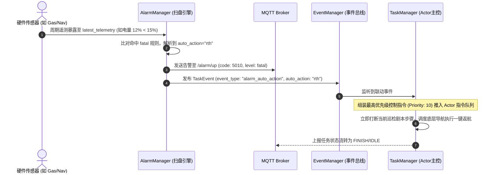

# 🚨 MQTT 故障与越界告警汇报 (Alarm Up) 协议规范

## 1. 协议元数据与告警引擎架构

* **Topic Pattern**: `/edge/gateway/{robot_id}/alarm/up`
* **通信方向**: 边缘网关 ➔ 云端平台
* **QoS 等级**: `QoS 1`（重要告警事件，确保必达）
* **三大触发引擎与机制**:
  1. **遥测阈值扫盘告警引擎 (`AlarmManager - Telemetry Sweep Engine`)**:
     - `TelemetryManager` 定时扫盘并广播 `telemetry_sweep_ready` 事件，`AlarmManager` 零耦合接收后，自动比对全量传感器 `latest_telemetry` 与落盘 JSON 规则。
     - **边沿触发机制**: 按 `channel_key` 记录上一次告警级别，仅在告警等级发生突变（如正常变为警告、警告升至致命）时触发上报，杜绝相同数值高频重复刷屏。
  2. **任务生命周期告警引擎 (`AlarmManager - Task Lifecycle Engine`)**:
     - 基于系统 `EventManager` 事件总线零耦合订阅任务状态突变事件（子任务失败、任务挂起、任务恢复、任务被取消）。
     - 支持按任务与事件维度的**时间窗口防抖抑制**（配置于 `configs/alarm_config.yaml`）。
  3. **底层驱动主动故障上报 (`Plugin Driver Direct Report`)**:
     - 当串口打开失败、TCP 网络断开、电机驱动器报故障码时，各插件主动调用统一告警入口 `MQTTManager.send_alarm(...)` 即时推送。
  4. **离线断网持久化补发保障 (`_offline_disk_queue`)**:
     - 所有告警报文发送时均经过网络连通性校验；若遇到网络闪断或 MQTT 离线，告警报文自动写入磁盘持久化队列，在网络重连后由后台守护线程以固定频率（`0.5s`）匀速可靠补发，绝不丢弃关键告警。

---

## 2. 告警等级划分与映射规范 (`level`)

网关严格遵循工业级四级告警划分体系：

| 告警级别 (`level`) | 权重优先级 | 业务语义与处置建议 | 兼容的别名字段 |
| :--- | :--- | :--- | :--- |
| `info` | P3 (最低) | **提示信息**: 状态恢复正常、任务恢复运行等通知类事件 | `notice` |
| `warning` | P2 | **预警信息**: 测温轻微偏高、电量偏低、任务暂停挂起 | `warn` |
| `error` | P1 | **严重故障**: 硬件通信断开、任务步骤执行失败、气体超限 | `severe`, `major` |
| `fatal` | P0 (最高) | **致命危险**: 硫化氢致死浓度、电量耗尽、起火高危，触发强制联动返航/停机 | `critical` |

---

## 3. 告警错误码矩阵 (Error Code Matrix)

| 错误码 (`code`) | 默认等级 (`level`) | 告警大类 | 典型触发源 | 触发场景与业务行为说明 |
| :--- | :--- | :--- | :--- | :--- |
| `5000` | `error` | 硬件通信故障 | `DoorPlugin`, `GasPlugin`, `ArmPlugin`, `StationPlugin` 等 | 串口未授权或无法打开、TCP Socket 连接超时、Modbus 校验和错误、驱动离线。 |
| `5001` | `error` | 任务步骤执行失败 | `TaskManager` (`subtask_failed`) | 剧本中某个步骤执行超时或失败。网关自动将总任务置为 `PAUSED` 挂起状态等待重试。 |
| `5002` | `warning` | 任务暂停挂起 | `TaskManager` (`task_paused`) | 收到平台 pause 指令或因避障/步骤异常触发自动挂起，受 `suppress_seconds` 防抖控制。 |
| `5003` | `info` | 任务恢复执行 | `TaskManager` (`task_resumed`) | 收到平台 resume 恢复指令，任务从原中断点重新恢复继续执行。 |
| `5004` | `warning` | 任务中断取消 | `TaskManager` (`task_cancelled`) | 任务在执行中或挂起时收到平台 abort 指令被强行取消。 |
| `5010` | `info` / `warning` / `error` / `fatal` | 遥测动态阈值越界 | `AlarmManager` (扫盘比对) | 气体超标、设备超温、底盘低电量、局放超标。支持配置 `auto_action` 自动联动打断任务。 |
| `6001` | `warning` / `error` | 瞬态富媒体特征告警 | `AcousticPlugin` | 声纹探头捕捉到异常放电/漏气脉冲，上报带 Base64 合成热力图与 PRPD 谱图的复合告警。 |

---

## 4. 报文载荷规范与典型示例

### 4.1 通用外层报文 Schema

```json
{
  "msg_id": "20260912-104500-111-222",
  "timestamp": 1726109100000,
  "robot_id": "robot888",
  "level": "error",
  "code": 5010,
  "message": "描述性告警内容",
  "data": { ... }
}
```

---

### 4.2 典型场景报文示例

#### 场景 1: 硬件通信中断 (`code: 5000`)
```json
{
  "msg_id": "ALARM_5000_1726109101",
  "timestamp": 1726109101000,
  "robot_id": "robot888",
  "level": "error",
  "code": 5000,
  "message": "开门机 [192.168.1.105:502] 通信异常: 连接超时拒绝 (TCP connect timeout)",
  "data": {
    "plugin_type": "DoorPlugin",
    "ip": "192.168.1.105",
    "port": 502
  }
}
```

#### 场景 2: 任务步骤失败导致总任务自动挂起 (`code: 5001`)
```json
{
  "msg_id": "ALARM_5001_1726109105",
  "timestamp": 1726109105000,
  "robot_id": "robot888",
  "level": "error",
  "code": 5001,
  "message": "任务[TASK_INSPECT_001]步骤3(插件:NavPlugin)执行失败: 导航路径被永久障碍物阻挡。总任务已自动挂起(PAUSED)，等待平台下发[重试/终止/返航]指令。",
  "data": {
    "task_id": "TASK_INSPECT_001",
    "task_name": "日常主变巡检",
    "subtask_id": "step_3",
    "step": 3,
    "step_index": 3,
    "plugin_type": "NavPlugin",
    "reason": "导航路径被永久障碍物阻挡",
    "event_type": "subtask_failed"
  }
}
```

#### 场景 3: 任务被云端强行终止取消 (`code: 5004`)
```json
{
  "msg_id": "ALARM_5004_1726109110",
  "timestamp": 1726109110000,
  "robot_id": "robot888",
  "level": "warning",
  "code": 5004,
  "message": "任务[TASK_INSPECT_001]已被平台强行终止/取消。终止原因: 收到云端 abort 强制打断指令",
  "data": {
    "task_id": "TASK_INSPECT_001",
    "task_name": "日常主变巡检",
    "step": 3,
    "plugin_type": "TaskManager",
    "reason": "收到云端 abort 强制打断指令",
    "event_type": "task_cancelled"
  }
}
```

#### 场景 4: 传感器动态阈值越界告警 (`code: 5010`)
支持气体（`CO2/CO/H2S/O2/EX/SF6/NOX`）、红外测温（`THERMAL`）、局放峰值（`PEAK`）、底盘电量（`BATTERY`）、底盘受阻（`BLOCKED`）等所有核心指标：
```json
{
  "msg_id": "ALARM_5010_1726109115",
  "timestamp": 1726109115000,
  "robot_id": "robot888",
  "level": "error",
  "code": 5010,
  "message": "可燃气体严重泄漏，爆炸隐患！ (当前数值: 32.5 %LEL)",
  "data": {
    "plugin_type": "GasPlugin",
    "sensor_id": 1,
    "channel_code": 5,
    "metric_name": "EX",
    "value": 32.5,
    "unit": "%LEL"
  }
}
```

#### 场景 4.1: 底盘遇障受阻告警 (`code: 5010`)
```json
{
  "msg_id": "ALARM_5010_1726109118",
  "timestamp": 1726109118000,
  "robot_id": "robot888",
  "level": "warning",
  "code": 5010,
  "message": "底盘移动被阻挡，请检查前方障碍物 (当前数值: 1 bool)",
  "data": {
    "plugin_type": "NavPlugin",
    "sensor_id": 1,
    "channel_code": 1,
    "metric_name": "BLOCKED",
    "value": 1,
    "unit": "bool"
  }
}
```

#### 场景 5: 局放峰值越限告警 (`code: 5010`)
```json
{
  "msg_id": "ALARM_5010_1726109120",
  "timestamp": 1726109120000,
  "robot_id": "robot888",
  "level": "error",
  "code": 5010,
  "message": "局放峰值严重超标，疑似存在严重绝缘放电隐患！ (当前数值: 38.6 dBm)",
  "data": {
    "plugin_type": "GdpdPlugin",
    "sensor_id": 1,
    "channel_code": 1,
    "metric_name": "PEAK",
    "value": 38.6,
    "unit": "dBm"
  }
}
```

#### 场景 6: 瞬态声纹捕捉与富媒体告警 (`code: 6001`)
声纹探头捕捉到瞬间异常声压（SPL 超过阈值），且伴随局放或异响时，上报带有声成像融合伪彩热力图与 PRPD 深度诊断指标的富媒体复合告警：
```json
{
  "msg_id": "20260918-124707-123-456",
  "timestamp": 1726634827000,
  "robot_id": "robot888",
  "level": "error",
  "code": 6001,
  "message": "声纹探头检测到异常声压 (95.00 dB)",
  "data": {
    "plugin_type": "AcousticPlugin",
    "spl": 95.0,
    "image_base64": "data:image/jpeg;base64,/9j/4AAQSkZJRgABAQE...",
    "discharge_acceptance": 98.5,
    "discharge_malfunction_grade": 2,
    "discharge_type": 1
  }
}
```

* **`data` 核心字段说明**：
  * `plugin_type` (`string`): 固定为 `"AcousticPlugin"`；
  * `spl` (`float`): 触发告警时刻的瞬态声压级，单位 `dB`；
  * `image_base64` (`string`): 叠加了 32×24 声成像高斯伪彩色热力图（JET 色谱）与可见光背景实景的复合 JPEG 图像 Base64 编码（包含 `data:image/jpeg;base64,` 前缀）；
  * `discharge_acceptance` (`float`): 局部放电故障置信度（范围 `0.0 ~ 100.0%`）；
  * `discharge_malfunction_grade` (`int`): 局放故障严重程度等级（`0`: 正常, `1`: 轻微, `2`: 注意, `3`: 严重）；
  * `discharge_type` (`int`): 局部放电物理类型分类（`0`: 无放电, `1`: 悬浮电位放电, `2`: 电晕放电, `3`: 沿面绝缘放电, `4`: 内部气隙放电）。

---

## 5. 防抖过滤与迟滞控制机制

为防止现场恶劣工况引起高频“告警风暴”，网关在不同层面应用了抑制控制算法：

### 5.1 任务生命周期防抖 (`suppress_seconds`)
定义在 `configs/alarm_config.yaml` 中，针对同一 `task_id` 和相同 `event_type` 设定防抖冷却时间。例如：
- `subtask_failed`: 冷却 `0s`（只要失败立即报警）；
- `task_paused`: 冷却 `3s`（避免短时间内重复推送到云端）。

### 5.2 遥测越界边沿触发 (Edge Triggering)
* `AlarmManager` 为每个物理测点生成唯一通道键：`channel_key = f"{plugin}_{sensor_id}_{channel}_{metric}"`。
* 状态机内部缓存各测点上一次的告警等级（`_last_alarm_state`）。
* **只有在告警等级发生阶梯跃迁时（例如从 `NORMAL` 跃迁为 `warning`，或从 `warning` 升级为 `error`）才会发出一次 MQTT 告警**。
* 遥测数据虽然持续每秒扫盘，但处于同一告警等级内波动时不会重复上报，彻底解决时序高频遥测带来的网络轰炸。
* 当数值回归安全阈值区间后，状态机会记录其恢复至 `NORMAL`，准备响应下一次越界。

---

## 6. 告警自动化动作联动架构 (`auto_action`)

当云端通过 `set_config` 下发的阈值规则中选配了 `auto_action`（如 `"rth"` 自动返航，或 `"abort"` 紧急停机）时，网关执行全闭环自动化处置机制：



