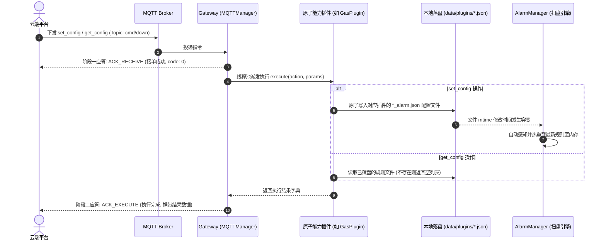

# 🛠️ 云端主动下发配置 (Config Down) 协议规范与指南

边缘网关基于**“配置即代码”**与**“文件 mtime 零耦合感知”**的架构，支持传感器与核心组件动态告警规则的热重载。云端平台可通过 MQTT 下行指令即时配置或查询各插件的告警阈值规则，网关在落盘至 `data/plugins/` 目录的同时瞬间热生效，无需重启任何网关进程或底层硬件驱动。

---

## 1. 通信协议与两阶段应答时序

### 1.1 Topic 定义
* **配置下行 Topic**: `/edge/gateway/{robot_id}/cmd/down`
* **应答上行 Topic**: `/edge/gateway/{robot_id}/cmd/up`
* **QoS 等级**: `QoS 1`（确保指令必达）

### 1.2 动作契约 (Action Contract)
所有支持动态阈值配置的能力插件，均统一支持两个标准动作：
* `action: "set_config"`：覆盖式持久化下发规则列表
* `action: "get_config"`：查询本地当前生效的规则列表

### 1.3 交互时序图



---

## 2. 告警规则通用模型规范 (Rule Schema)

下发给 `set_config` 的 `params.config` 为规则对象数组，单条规则的结构定义如下：

| 字段名 | 类型 | 必填 | 描述与示例 |
| :--- | :--- | :--- | :--- |
| `metric_name` | String | **是** | 监控指标名称（统一大写），如 `EX`、`CO`、`THERMAL`、`BATTERY`、`PEAK`、`SPL` |
| `unit` | String | 否 | 工程计量单位，如 `PPM`、`%VOL`、`%LEL`、`℃`、`%`、`dBm`、`dB` |
| `thresholds` | Object | **是** | 分级告警规则字典，包含 `fatal`、`error`、`warning`、`info` 四个等级 |

### 2.1 阈值等级与算子引擎 (`thresholds`)
网关内置的算子引擎按 `fatal -> error -> warning -> info` 的优先级顺序依次匹配：

```json
"thresholds": {
  "warning": {
    "operator": "gte",
    "value": 20.0,
    "message": "轻度超标预警"
  },
  "fatal": {
    "operator": "gt",
    "value": 50.0,
    "message": "浓度极度危险报警，强制返航！",
    "auto_action": "rth"
  }
}
```

* **支持的比较算子 (`operator`)**:
  - `gt`: 大于 (`value > threshold`)
  - `gte`: 大于等于 (`value >= threshold`)
  - `lt`: 小于 (`value < threshold`)
  - `lte`: 小于等于 (`value <= threshold`)
  - `eq`: 严格相等 (`value == threshold`)
  - `between`: 闭区间范围匹配（此时 `value` 必须为包含两个浮点数的数组 `[min, max]`，满足 `min <= value <= max`）
* **告警自动化联动 (`auto_action`)**:
  可选字段。当遥测数据命中该规则时，`AlarmManager` 不仅向上报 `/alarm/up` 告警（错误码 5010），还会向全局事件总线发布 `alarm_auto_action` 事件，由 `TaskManager` 强制打断当前任务并执行联动控制：
  - `"abort"`: 紧急停止当前正在执行的巡检剧本并锁轴。
  - `"rth"`: 自动终止任务并控制机器人一键安全返航。

---

## 3. 各能力插件配置与下发规范

目前网关共有 5 个核心感知与导航插件支持动态阈值配置：

### 3.1 气体检测插件 (`GasPlugin`)
* **落盘目标文件**: `data/plugins/GasPlugin_alarm.json`
* **支持指标 (`config_metrics`)**: `CO2`, `CO`, `H2S`, `O2`, `EX`, `SF6`, `NOX`

**下发配置请求 (Cloud -> Gateway)**:
```json
{
  "msg_id": "MSG_SET_GAS_01",
  "cmd_type": "action",
  "plugin_type": "GasPlugin",
  "action": "set_config",
  "params": {
    "config": [
      {
        "metric_name": "EX",
        "unit": "%LEL",
        "thresholds": {
          "warning": { "operator": "gte", "value": 10.0, "message": "可燃气体微量泄漏预警" },
          "error": { "operator": "gte", "value": 25.0, "message": "可燃气体浓度超限报警" },
          "fatal": { "operator": "gte", "value": 50.0, "message": "可燃气体严重超标，爆炸危险！", "auto_action": "abort" }
        }
      },
      {
        "metric_name": "H2S",
        "unit": "PPM",
        "thresholds": {
          "fatal": { "operator": "gte", "value": 20.0, "message": "硫化氢致死浓度报警，立即返航！", "auto_action": "rth" }
        }
      }
    ]
  }
}
```

---

### 3.2 双光测温摄像头插件 (`CameraPlugin`)
* **落盘目标文件**: `data/plugins/CameraPlugin_alarm.json`
* **支持指标 (`config_metrics`)**: `THERMAL` (最高温度，单位 `℃`)

**下发配置请求 (Cloud -> Gateway)**:
```json
{
  "msg_id": "MSG_SET_CAM_01",
  "cmd_type": "action",
  "plugin_type": "CameraPlugin",
  "action": "set_config",
  "params": {
    "config": [
      {
        "metric_name": "THERMAL",
        "unit": "℃",
        "thresholds": {
          "info": { "operator": "between", "value": [10.0, 70.0], "message": "设备表面温度轻微偏高提示" },
          "warning": { "operator": "between", "value": [70.0, 90.0], "message": "设备温度偏高预警，请注意巡检" },
          "error": { "operator": "between", "value": [90.0, 110.0], "message": "设备超温告警，存在过热损坏危险！" },
          "fatal": { "operator": "gte", "value": 110.0, "message": "温度极度异常，起火隐患！", "auto_action": "abort" }
        }
      }
    ]
  }
}
```

---

### 3.3 激光导航底盘插件 (`NavPlugin`)
* **落盘目标文件**: `data/plugins/NavPlugin_alarm.json`
* **支持指标 (`config_metrics`)**: 
  * `BATTERY` (底盘剩余电量，单位 `%`)
  * `BLOCKED` (底盘遇障受阻，单位 `bool`，取值 `0/1`)

**下发配置请求 (Cloud -> Gateway)**:
```json
{
  "msg_id": "MSG_SET_NAV_01",
  "cmd_type": "action",
  "plugin_type": "NavPlugin",
  "action": "set_config",
  "params": {
    "config": [
      {
        "metric_name": "BATTERY",
        "unit": "%",
        "thresholds": {
          "warning": { "operator": "lt", "value": 30.0, "message": "底盘电量低于30%，建议及时充电" },
          "fatal": { "operator": "lt", "value": 15.0, "message": "底盘电量严重不足(低于15%)，立即强制中断返航！", "auto_action": "rth" }
        }
      },
      {
        "metric_name": "BLOCKED",
        "unit": "bool",
        "thresholds": {
          "warning": { "operator": "eq", "value": 1, "message": "底盘移动被阻挡，请检查前方障碍物" }
        }
      }
    ]
  }
}
```

---

### 3.4 局部放电检测插件 (`GdpdPlugin`)
* **落盘目标文件**: `data/plugins/GdpdPlugin_alarm.json`
* **支持指标 (`config_metrics`)**: `PEAK` (局放峰值，单位 `dBm`)

**下发配置请求 (Cloud -> Gateway)**:
```json
{
  "msg_id": "MSG_SET_GDPD_01",
  "cmd_type": "action",
  "plugin_type": "GdpdPlugin",
  "action": "set_config",
  "params": {
    "config": [
      {
        "metric_name": "PEAK",
        "unit": "dBm",
        "thresholds": {
          "warning": { "operator": "gte", "value": 20.0, "message": "局放峰值异常偏高预警" },
          "error": { "operator": "gte", "value": 35.0, "message": "局放峰值严重超标，疑似存在严重绝缘放电隐患！" }
        }
      }
    ]
  }
}
```

---

### 3.5 声纹检测插件 (`AcousticPlugin`)
* **落盘目标文件**: `data/plugins/AcousticPlugin_alarm.json`
* **支持指标 (`config_metrics`)**: `SPL` (声压级，单位 `dB`)

**下发配置请求 (Cloud -> Gateway)**:
```json
{
  "msg_id": "MSG_SET_ACST_01",
  "cmd_type": "action",
  "plugin_type": "AcousticPlugin",
  "action": "set_config",
  "params": {
    "config": [
      {
        "metric_name": "SPL",
        "unit": "dB",
        "thresholds": {
          "warning": { "operator": "gte", "value": 65.0, "message": "声纹底噪偏高预警" },
          "error": { "operator": "gte", "value": 75.5, "message": "捕获到异常放电/漏气声纹(声压级超标)" }
        }
      }
    ]
  }
}
```

---

## 4. 下发配置的标准应答 (Gateway Responses)

### 阶段一：接单响应 (`ACK_RECEIVE`)
```json
{
  "msg_id": "MSG_SET_GAS_01",
  "timestamp": 1726108800000,
  "robot_id": "robot888",
  "reply_type": "ACK_RECEIVE",
  "code": 0,
  "message": "网关已接收指令，正在调度执行"
}
```

### 阶段二：执行成功响应 (`ACK_EXECUTE`)
```json
{
  "msg_id": "MSG_SET_GAS_01",
  "timestamp": 1726108800028,
  "robot_id": "robot888",
  "reply_type": "ACK_EXECUTE",
  "code": 0,
  "message": "动作执行成功",
  "data": {
    "result": {
      "status": "success",
      "message": "成功保存气体告警配置至 /home/zonwey/robot_project/data/plugins/GasPlugin_alarm.json",
      "data": [ ... ]
    },
    "duration_ms": 28
  }
}
```

---

## 5. 读取当前生效配置 (`get_config`)

云端可通过 `get_config` 查询任何插件当前生效的规则数组。

### 5.1 请求报文格式
```json
{
  "msg_id": "MSG_GET_CFG_01",
  "cmd_type": "action",
  "plugin_type": "GasPlugin",
  "action": "get_config",
  "params": {}
}
```

### 5.2 返回报文：存在已落盘规则
```json
{
  "msg_id": "MSG_GET_CFG_01",
  "timestamp": 1726108810015,
  "robot_id": "robot888",
  "reply_type": "ACK_EXECUTE",
  "code": 0,
  "message": "动作执行成功",
  "data": {
    "result": {
      "status": "success",
      "message": "成功获取气体告警配置",
      "data": [
        {
          "metric_name": "EX",
          "unit": "%LEL",
          "thresholds": {
            "error": {
              "operator": "gte",
              "value": 25.0,
              "message": "可燃气体浓度超限报警"
            }
          }
        }
      ]
    },
    "duration_ms": 15
  }
}
```

### 5.3 返回报文：尚未配置任何自定义规则（文件不存在）
当该插件本地尚未生成或未落盘过 `*_alarm.json` 时，插件返回空列表（保证前端渲染表单时不报异常）：
```json
{
  "msg_id": "MSG_GET_CFG_02",
  "timestamp": 1726108820010,
  "robot_id": "robot888",
  "reply_type": "ACK_EXECUTE",
  "code": 0,
  "message": "动作执行成功",
  "data": {
    "result": {
      "status": "success",
      "message": "尚未配置自定义告警规则，当前无本地配置文件",
      "data": []
    },
    "duration_ms": 10
  }
}
```

---

## 6. 开发者与集成注意事项

1. **零代码重启热加载**:
   - `AlarmManager` 采用基于文件系统 `mtime` 的懒加载扫盘机制。当 `set_config` 完成磁盘写入后，在下一次遥测评估周期（$\le 1.0\text{ s}$）内即可自动加载并生效，无需重启边缘网关或驱动。
2. **规则覆盖与备份**:
   - `set_config` 为全量覆盖写入。云端若需在现有规则上追加指标，应先通过 `get_config` 获取当前全量列表，在客户端完成数组追加后再下发 `set_config`。
3. **指标一致性检验**:
   - 配置规则下发的 `metric_name` 应严格与该插件在 `capability/up` 中暴露的 `config_metrics.metric_name` 保持一致（大小写敏感，统一建议全大写），否则告警判定引擎无法正确关联遥测数据通道。

