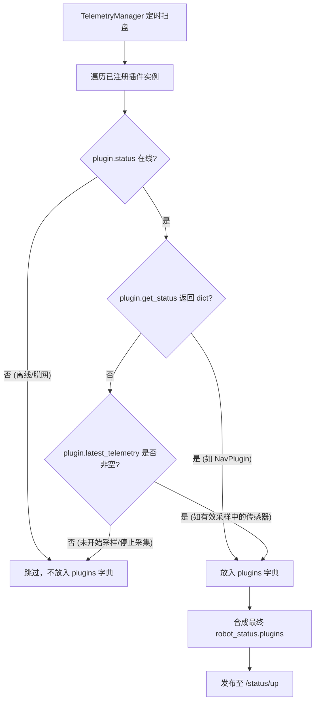

# 📡 MQTT 实时状态汇报 (Status Up) 协议规范

## 1. 协议元数据与工作机制

* **Topic Pattern**: `/edge/gateway/{robot_id}/status/up`
* **通信方向**: 边缘网关 ➔ 云端平台
* **QoS 等级**: `QoS 0`（高频时序数据，追求实时性与低带宽开销）
* **核心驱动与触发机制**:
  1. **周期性心跳扫盘 (`TelemetryManager`)**:
     - 网关后台运行专职的 `TelemetryManager` 线程，按配置周期（默认 `5.0s`）对当前所有已挂载插件进行状态与遥测自动聚合扫盘。
     - **告警事件联动**: 每次扫盘前，网关会通过系统内部 `EventManager` 发布 `telemetry_sweep_ready` 事件，触发独立解耦的 `AlarmManager` 瞬间执行越界比对与联动评估。
  2. **事件驱动即时推送 (`MQTTManager.publish_status`)**:
     - 当底盘、导航控制器或底层传感器产生状态突变（如到达导航点、状态切换）时，允许直接触发状态即时上报。
     - **内置内存防抖过滤**: `MQTTManager` 内部维护 `_last_status_pub_time`，强制执行 `0.5s` 内存级防重与平滑滤波，防止突发事件导致 MQTT Broker 发生拥塞。
  3. **离线消息缓冲机制**:
     - 若本地 MQTT 连接断开或网络闪断，未成功投递的最新状态将自动压入内存队列 `_offline_status_queue`，在网络重建成功后进行恢复处理。

---

## 2. 状态机枚举定义 (`task_state`)

状态值实时取自系统 `TaskManager.get_task_state()`：

| 状态枚举 | 含义说明 | 允许的平台控制动作 |
| :--- | :--- | :--- |
| `IDLE` | 网关处于待机空闲状态，当前无剧本任务在执行 | 下发新任务 (`task`)、单能力调试动作 (`action`)、设置阈值 (`set_config`) |
| `RUNNING` | 正在执行多步骤巡检剧本或宏业务组件 | 暂停 (`pause`)、强行终止 (`abort`)、一键返航 (`rth`) |
| `PAUSED` | 任务被平台主动暂停，或因步骤异常/避障受阻而自动挂起 | 恢复任务 (`resume`)、终止 (`abort`)、返航 (`rth`) |
| `FINISH` | 任务全流程步骤已全部成功执行完毕 | 自动复位流转至 `IDLE` |
| `FAILED` | 任务执行最终失败且未处于挂起重试状态 | 下发新任务、复位 |
| `ABORTED` | 任务被云端指令或本地急停/告警联动强制打断退出 | 下发新任务、复位 |

---

## 3. 完整报文载荷示例 (Payload Schema)

```json
{
  "msg_id": "20260912-103000-123-456",
  "timestamp": 1726108200000,
  "robot_id": "robot888",
  "task_state": "RUNNING",
  "robot_status": {
    "plugins": {
      "NavPlugin": {
        "mode": "AUTO",
        "error": "",
        "result": "",
        "chassis": {
          "speed_x": 0.0,
          "speed_y": 0.0,
          "speed_theta": 0.0,
          "emergency_stop": false
        },
        "battery": {
          "percentage": 92.5,
          "is_charging": false,
          "voltage": 24.8
        },
        "map": {
          "map_name": "substation_floor_1"
        },
        "localization": {
          "x": 12.34,
          "y": 56.78,
          "theta": 1.5708
        },
        "navigation": {
          "status": "NAVIGATING",
          "current_goal": 15
        }
      },
      "GasPlugin": [
        {
          "sensor_id": 1,
          "channel_code": 1,
          "name": "CO2",
          "value": 450.0,
          "unit": "PPM",
          "status": "NORMAL"
        },
        {
          "sensor_id": 1,
          "channel_code": 2,
          "name": "CO",
          "value": 12.5,
          "unit": "PPM",
          "status": "NORMAL"
        },
        {
          "sensor_id": 1,
          "channel_code": 3,
          "name": "H2S",
          "value": 0.0,
          "unit": "PPM",
          "status": "NORMAL"
        },
        {
          "sensor_id": 1,
          "channel_code": 4,
          "name": "O2",
          "value": 20.9,
          "unit": "%VOL",
          "status": "NORMAL"
        },
        {
          "sensor_id": 1,
          "channel_code": 5,
          "name": "EX",
          "value": 0.0,
          "unit": "%LEL",
          "status": "NORMAL"
        },
        {
          "sensor_id": 2,
          "channel_code": 1,
          "name": "SF6",
          "value": 0.0,
          "unit": "PPM",
          "status": "NORMAL"
        },
        {
          "sensor_id": 2,
          "channel_code": 2,
          "name": "NOX",
          "value": 0.0,
          "unit": "PPM",
          "status": "NORMAL"
        }
      ],
      "CameraPlugin": [
        {
          "metric_name": "THERMAL",
          "max_temp": 38.2,
          "min_temp": 21.5,
          "avg_temp": 28.7
        }
      ],
      "GdpdPlugin": [
        {
          "metric_name": "PEAK",
          "name": "PEAK",
          "label": "局放峰值",
          "value": 24.5,
          "unit": "dBm"
        }
      ],
      "AcousticPlugin": [
        {
          "metric_name": "SPL_TELEMETRY",
          "value": 56.52,
          "unit": "dB"
        }
      ]
    }
  }
}
```

---

## 4. 各插件遥测数据结构详析 (Plugin Telemetry Specs)

`robot_status.plugins` 字典内部以插件类名（`PluginName`）作为 Key，其实际数据载荷由底层插件的具体实现决定：

### 4.1 导航定位插件 (`NavPlugin`)
* **数据类型**: `Object`（定制化复合状态字典，来自 `NavPlugin.get_status()`）
* **触发条件**: 底盘在线且通信正常时返回。
* **主要字段**:
  - `mode`: 当前运行模式 (`"AUTO"` / `"MANU"`)。
  - `chassis`: 底盘运动学状态（包含 `speed_x`, `speed_y`, `speed_theta` 以及急停标志 `emergency_stop`）。
  - `battery`: 电量信息（包含 `percentage` 电量百分比、`is_charging` 是否充电中、`voltage` 电压）。
  - `map`: 当前加载并匹配的地图名称 `map_name`。
  - `localization`: 当前全局位姿坐标（`x`, `y`, `theta` 弧度角）。
  - `navigation`: 当前导航执行状态（`status`: `"NAVIGATING"`, `"FINISH"`, `"BLOCKED"`, `"FAILED"`, `"IDLE"` 等；`current_goal`: 目标点位 ID）。

### 4.2 气体检测插件 (`GasPlugin`)
* **数据类型**: `Array[Object]`（来自 `GasPlugin.latest_telemetry`）
* **触发条件**: 当气泵开启并进入循环采样阶段 (`cycle: start` 或单次 `acquire` 成功采集后) 自动暴露；气泵停止或无有效读数时自动置为 `None`（剪枝）。
* **数组元素字段**:
  - `sensor_id`: 硬件模组 ID（例如 `1` 表示 6合一，`2` 表示 1合一模组）。
  - `channel_code`: 模组内的物理通道编号 (1-6)。
  - `name`: 气体名称（如 `"CO2"`, `"CO"`, `"H2S"`, `"O2"`, `"EX"`, `"SF6"`, `"NOX"`）。
  - `value`: 采集到的浓度浮点数值。
  - `unit`: 浓度计量单位（`"PPM"`, `"%VOL"`, `"%LEL"`）。
  - `status`: 当前通道状态标志（`"NORMAL"` 正常，`"ALARM"` 硬件级越限告警）。

### 4.3 双光测温摄像头插件 (`CameraPlugin`)
* **数据类型**: `Array[Object]`（来自 `CameraPlugin.latest_telemetry`）
* **触发条件**: 开启后台循环测温线程后定期抓取；无有效测温数据或读数失败时为 `None`。
* **数组元素字段**:
  - `metric_name`: 固定为 `"THERMAL"`。
  - `max_temp`: 视场区域最高温度（℃）。
  - `min_temp`: 视场区域最低温度（℃）。
  - `avg_temp`: 视场区域平均温度（℃）。

### 4.4 局部放电检测插件 (`GdpdPlugin`)
* **数据类型**: `Array[Object]`（来自 `GdpdPlugin.latest_telemetry`）
* **触发条件**: 局放检测完成全闭环采样 (`monitor`) 或单次采样 (`acquire`) 成功后更新。
* **数组元素字段**:
  - `metric_name`: 指标名称，固定为 `"PEAK"`（对齐 `config_metrics` 局放峰值）。
  - `name`: `"PEAK"`。
  - `label`: `"局放峰值"`。
  - `value`: 采样统计的最大峰值强度（浮点数）。
  - `unit`: 计量单位，固定为 `"dBm"`。

### 4.5 声纹检测插件 (`AcousticPlugin`)
* **数据类型**: `Array[Object]`（来自 `AcousticPlugin.latest_telemetry`）
* **触发条件**: 当声纹开启循环采集 (`cycle: start`) 时，由底层驱动的 TCP 数据帧回调持续刷新；未使能循环采集时为 `None`。
* **数组元素字段**:
  - `metric_name`: 固定为 `"SPL_TELEMETRY"`。
  - `value`: 实时瞬态声压级读数（dB）。
  - `unit`: `"dB"`。

---

## 5. 自动剪枝与动态轻量化规则 (Pruning & Lifecycle Rule)

`TelemetryManager` 采用“**无真实有效数据不伪造、不冗余上报**”的自动剪枝设计：



1. **执行机构与动作型插件不上报空假遥测**:
   - `DoorPlugin`（开门机）、`ElevatorPlugin`（电梯）、`StationPlugin`（充电桩）、`ArmPlugin`（机械臂）、`RecordPlugin`（录像插件）、`SystemPlugin`（系统基础）：
   - 上述插件属于纯任务执行机构或后台离线服务，其运行状态由专项动作（如 `record_status`）主动查询，未定义持续上报的标量遥测时序数据，因此不会以空字典或伪造数据常驻 `status/up` 报文中。
2. **传感器启停状态动态感知**:
   - 诸如气体传感器在关泵状态、声纹探头在停止循环采样时，其内部 `latest_telemetry` 会被显式置为 `None`。
   - 扫盘引擎感知到 `None` 后会自动将该插件从当前周期的 `plugins` 列表中剔除，避免云端被失效的历史缓存数据误导。
3. **云端消费端最佳实践**:
   - 云端平台在解析 `robot_status.plugins` 时，应使用安全字典查询语法（如 `plugins.get("CameraPlugin")`）。
   - 插件 Key 存在且非空表示该硬件外设当前处于在线且有效采样状态；Key 不存在即表示该硬件处于待机静默、停止采样或离线状态。

