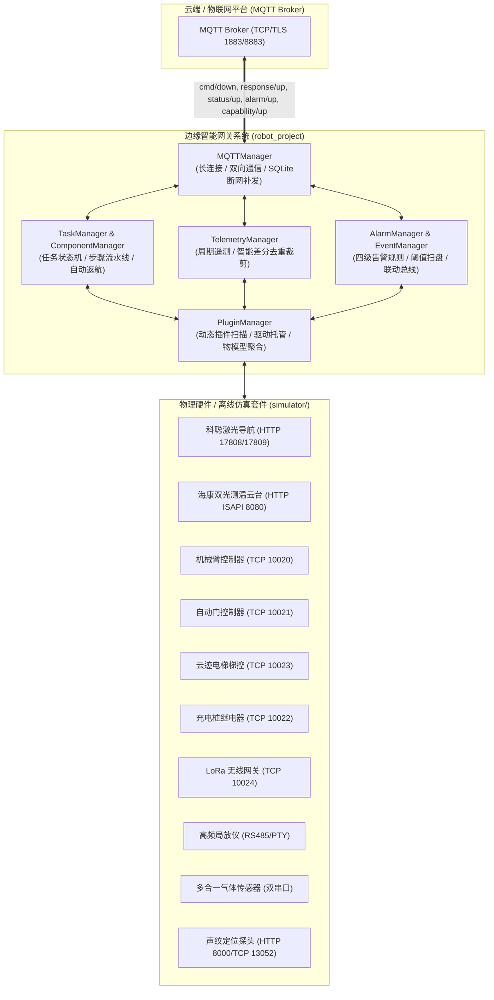

# 🚀 工业边缘智能网关生产部署与运维手册 (Deployment & Operations Guide)

本文档面向现场交付与运维工程师，提供边缘智能网关（工控机 IPC、车载计算盒 Jetson/RK3588）的标准化部署、服务守护、离线仿真、验收验证及排障速查 SOP。

---

## 1. 系统架构与组件拓扑

网关采用解耦的事件驱动分层架构，向上与云端物联网平台通过 MQTT 双向通信，向下纳管异构硬件与传感器外设：



---

## 2. 环境准备与依赖一键安装

### 2.1 系统基线与前置依赖

* **系统要求**：Ubuntu 20.04 / 22.04 LTS（x86_64 或 aarch64 如 Jetson / RK3588）
* **Python 版本**：**严格要求 `Python == 3.10.*`**
* **包管理工具**：PDM (Python Development Master)

在工控机上安装基础系统动态库与工具：

```bash
# 1. 系统依赖安装 (含 SQLite3、网络工具、串口调试工具及 OpenCV/PyAV 依赖库)
sudo apt update && sudo apt install -y \
  python3.10 python3.10-venv python3.10-dev python3-pip \
  sqlite3 curl git net-tools socat \
  libgl1 libglib2.0-0 libsm6 libxext6 libxrender-dev

# 2. 赋予当前用户操作硬件串口免 root 权限 (执行后重新登录终端生效)
sudo usermod -aG dialout $USER
```

### 2.2 执行一键环境检测与依赖安装

项目提供全自动化的环境自检与依赖拉取脚本 `1_setup_env.sh`：

```bash
cd /opt/robot_project
chmod +x 1_setup_env.sh 2_install_service.sh uninstall_service.sh

# 执行一键自检与依赖拉取 (自动配置国内清华源加速)
./1_setup_env.sh

# 提示：若需强制忽略本地缓存全量重新拉取依赖，附加 --force 参数：
# ./1_setup_env.sh --force
```

> **`1_setup_env.sh` 核心流水线**：
> 1. **Python 基线检测**：智能查找系统 Python 3.10+，缺少 pip 时自动通过 `ensurepip` 修复；
> 2. **PDM 自动就绪**：未安装时自动通过国内镜像源极速安装至用户目录并配置 PATH；
> 3. **极速完整性自检**：毫秒级校验 9 大关键依赖库；若已就绪且无 `--force` 则跳过耗时网络拉取；
> 4. **依赖锁定同步**：自动绑定 Python 3.10 解释器并执行 `pdm install --dev`；
> 5. **健康自检**：对核心模块导入与 `FFmpegResolver` 二进制动态寻址进行全量自检。

---

## 3. 配置文件体系速查

网关配置采用分层解耦体系：

```text
configs/
├── config.yaml          # 全局核心配置 (MQTT Broker、场站标识、心跳周期)
├── alarm_config.yaml    # 任务执行告警规则 (支持 mtime 毫秒级热重载)
└── reverse_rules.yaml   # 任务打断/取消时的原子插件逆向复位规则
components/config.yaml   # 业务宏组件启停配置 (按需加载控制)
plugins/<plugin>/config.yaml # 各具体硬件插件专属通信与物理端口参数
data/plugins/*.json      # 云端动态下发持久化的传感器分级告警阈值文件
```

### 3.1 全局基础配置 (`configs/config.yaml`)

```yaml
gateway:
  version: "0.1.0"
  location: "xian_lab"             # 现场场站标识
  auto_rth_timeout_sec: 300       # 任务挂起超时自动返航时间 (秒)

mqtt:
  broker_ip: "192.168.3.36"       # MQTT Broker IP
  port: 1883                      # 端口
  robot_id: "P2026083101"         # 机器人唯一物模型资产标识 (决定 Topic 命名空间)
  client_id: "Dog_Gateway"
  username: "robot2"
  password: "CHANGE_ME"
  heartbeat_interval: 5.0         # 遥测上报 (status/up) 周期 (秒)

log_level: "DEBUG"                # 日志级别: DEBUG | INFO | WARNING | ERROR
```

### 3.2 常用硬件插件独立配置速查

各插件配置文件位于 `plugins/<plugin_dir>/config.yaml`：

| 插件名称 (`plugin_type`) | 配置文件路径 | 通信方式与现场参数示例 | 关键说明 |
| :--- | :--- | :--- | :--- |
| **`NavPlugin`** | `plugins/navigation/config.yaml` | HTTP REST `ip: 127.0.0.1`, `port: 17808`<br>主动推送监听 `push_port: 17809` | 科聪 MRC 导航控制器 (`robot_type`: 514/513) |
| **`CameraPlugin`** | `plugins/camera/config.yaml` | HTTP ISAPI `ip: 127.0.0.1`, `port: 8080`<br>`username: "admin"`, `password: "CHANGE_ME"` | 海康威视双光热成像测温云台相机 |
| **`RecordPlugin`** | `plugins/record/config.yaml` | RTSP 视频流拉取 + SeaweedFS REST (8888) | fMP4 切片录像、无任务状态门控与上云即焚 |
| **`ArmPlugin`** | `plugins/arm/config.yaml` | TCP Socket `ip: 127.0.0.1`, `port: 10020` | 车载六自由度工业机械臂控制器 |
| **`DoorPlugin`** | `plugins/door/config.yaml` | TCP Socket `connect_timeout: 5.0` | 自动门机控制器 |
| **`ElevatorPlugin`** | `plugins/elevator/config.yaml`| TCP Socket `ip: 127.0.0.1`, `port: 10023` | 云迹智能乘梯调度网关 |
| **`StationPlugin`** | `plugins/station/config.yaml` | TCP Socket `ip: 127.0.0.1`, `port: 10022` | 充电桩对接机构与继电器吸合控制 |
| **`LoraPlugin`** | `plugins/lora/config.yaml` | TCP Socket `host: 127.0.0.1`, `port: 10024` | 433MHz/868MHz 广播监听与网关通信 |
| **`GdpdPlugin`** | `plugins/gdpd/config.yaml` | Serial/PTY `port: /tmp/tty_gdpd_sim`, `baudrate: 9600` | 高频局部放电检测仪 (现场为 `/dev/ttyUSB0`) |
| **`GasPlugin`** | `plugins/gas/config.yaml` | Serial/PTY 串口1/串口2 | 6合1 复合气体模组 + SF6 气体检测 |
| **`AcousticPlugin`** | `plugins/acoustic/config.yaml`| HTTP REST `port: 8000`, TCP `port: 13052` | 声纹定位矩阵阵列探头 |

---

## 4. 运行模式与 Systemd 守护部署

### 4.1 前台交互运行（调试诊断）

```bash
cd /opt/robot_project
pdm run python main.py
```
控制台将输出彩色日志，可直接观察 MQTT 连接、插件扫描与任务流；按 `Ctrl+C` 触发优雅停机。

### 4.2 生产环境一键部署与管理

项目通过 `2_install_service.sh` 与 `uninstall_service.sh` 提供标准化生产守护治理：

```bash
# 1. 一键安装并启动自启守护服务 (必须 sudo)
sudo ./2_install_service.sh
```

> **`2_install_service.sh` 自动化保障**：
> * **防权限污染**：自动识别实际登录用户 (`${SUDO_USER}`)，修复 `data/` 与 `logs/` 属主，避免 root 权限污染开发环境；
> * **环境闭环**：缺失 `.venv` 时自动无缝调用 `1_setup_env.sh` 完成前置安装；
> * **免密自愈授权**：写入 `/etc/sudoers.d/robot-gateway`，支持 `SystemPlugin` 远程执行服务重启和系统自愈重启，并经 `visudo -c -f` 语法校验；
> * **守护单元配置**：写入 `/etc/systemd/system/robot-gateway.service`（配置 `Restart=always`、`RestartSec=3s`、`TimeoutStopSec=10s`、`KillSignal=SIGTERM`、`LimitNOFILE=65535`、`LANG=zh_CN.UTF-8`）；
> * **自动激活启动**：完成重载、开机自启并即时校验服务 active 状态。

#### 常用服务运维命令

```bash
# 查看服务实时状态
systemctl status robot-gateway

# 跟踪查看实时运行日志 (最后 50 行)
journalctl -u robot-gateway -f -n 50

# 重启 / 停止网关服务
sudo systemctl restart robot-gateway
sudo systemctl stop robot-gateway
```

#### 一键完全卸载服务

```bash
# 一键卸载 systemd 服务并清理提权规则
sudo ./uninstall_service.sh
```
> [!NOTE]
> 卸载脚本仅清理系统级服务单元与 sudoers 规则，**完整保留**源码、虚拟环境 (`.venv/`) 与业务数据 (`data/`、`logs/`)。

---

## 5. 离线仿真模拟器套件 (`simulator/`)

无需物理外设即可进行脱机全链路闭环仿真与调试：

| 模拟服务 | 文件路径 | 通信接口 | 模拟的核心硬件行为 |
| :--- | :--- | :--- | :--- |
| **机械臂** | `simulator/armSimulator.py` | TCP `10020` | 姿态到位校验、复位、坐标插值与报警 |
| **开门机** | `simulator/doorSimulator.py` | TCP `10021` | 开门、关门、开/关到位状态轮询与超时 |
| **气体传感器**| `simulator/gasSimulator.py` | PTY 虚拟双串口<br>`/tmp/tty_gas_sim0, 1` | 模拟 6合1 模组与 SF6 真实气体多通道数值 |
| **充电站** | `simulator/stationSimulator.py` | TCP `10022` | 充电继电器吸合/断开、进站/出站到位状态 |
| **云迹梯控** | `simulator/elevatorSimulator.py`| TCP `10023` | 呼梯、选层换楼、轿厢楼层广播与门到位 |
| **LoRa 网关**| `simulator/loraSimulator.py` | TCP `10024` | 0x50 心跳包、0x60 报文转发与延时反馈 |
| **局放监测** | `simulator/gdpdSimulator.py` | PTY 虚拟串口 `/tmp/tty_gdpd_sim` | 局放脉冲计数 (PC) 与峰值 (dBm) 数据模拟 |
| **激光导航** | `simulator/navSimulator.py` | HTTP REST `17808` | 站点移动、建图、位姿推送与激光雷达状态 |
| **双光云台** | `simulator/cameraSimulator.py`| HTTP ISAPI `8080` (Digest) | PTZ 转动、预置位、可见光与热成像测温矩阵 |
| **声纹定位** | `simulator/acousticSimulator.py`| HTTP `8000` & TCP `13052` | 声压级 (SPL)、PRPD 诊断与音频原始报文 |

```bash
# 一键拉起全部 10 大硬件模拟器 (自动使用 pty 创建虚拟串口)
pdm run python simulator/start_all_simulators.py

# 单组件定点启动 (示例)
pdm run python simulator/armSimulator.py 10020
```

---

## 6. 交付验收测试 SOP

部署完成后按以下步骤进行上线验收：

### 步骤 1: 自动化测试验证
```bash
pdm run pytest -v
```
预期输出：核心模块与各插件全部 `PASSED`。

### 步骤 2: 监听 MQTT 上行通道
```bash
mosquitto_sub -h 192.168.3.36 -p 1883 -u robot2 -P CHANGE_ME -t "/edge/gateway/P2026083101/#" -v
```

### 步骤 3: 验证物模型能力自动上报 (`capability/up`)
* 启动后网关自动推送一次包含所有插件能力、支持动作及 `config_metrics` 的全量物模型定义。

### 步骤 4: 验证周期遥测与差分去重 (`status/up`)
* 默认每 `5.0s` 收到一帧遥测；未发生数值跃迁时自动裁剪冗余字段，保障弱网信道带宽。

### 步骤 5: 验证指令下发与两阶段 ACK (`cmd/down` -> `response/up`)
使用 `mosquitto_pub` 发送即时动作指令：
```bash
mosquitto_pub -h 192.168.3.36 -p 1883 -u robot2 -P CHANGE_ME \
  -t "/edge/gateway/P2026083101/cmd/down" \
  -m '{"msg_id": "TEST_001", "cmd_type": "action", "plugin_type": "AcousticPlugin", "action": "query_spl", "params": {}}'
```
* **接单应答 (`ACK_RECEIVE`)**：`{"msg_id": "TEST_001", "reply_type": "ACK_RECEIVE", "code": 0, "message": "网关已接收指令，正在调度执行"}`
* **完成应答 (`ACK_EXECUTE`)**：`{"msg_id": "TEST_001", "reply_type": "ACK_EXECUTE", "code": 0, "data": {...}}`

---

## 7. 数据持久化与存储管理

```text
data/
├── mqtt_offline.db        # 断网离线持久化队列 (SQLite)
├── plugins/*.json         # 云端动态下发持久化的分级告警阈值
└── tasks/*.json           # 离线任务链与剧本持久化存储
```

* **断网补发机制**：网络中断时发往 `/response/up` 与 `/alarm/up` 的 QoS 1 报文存入 SQLite；网络恢复后常驻后台以 **0.5s 匀速逐条重发**并出库。
* **离线队列健康检查与清理**：
  ```bash
  # 查看积压消息数
  sqlite3 data/mqtt_offline.db "SELECT count(*) FROM offline_messages;"

  # 清空历史死信积压
  sqlite3 data/mqtt_offline.db "DELETE FROM offline_messages; VACUUM;"
  ```

---

## 8. 日志体系与排障速查表

* **日志路径**：`logs/gateway.log`
* **切割与保留**：每天午夜 (00:00) 自动按天归档切割 (`gateway.log.YYYY-MM-DD`)，自动保留最近 **30 天**。
* **实时监控**：
  ```bash
  tail -f logs/gateway.log
  tail -f logs/gateway.log | grep -E "ERROR|CRITICAL"
  ```

### 常见故障排障速查表

| 故障现象 | 根因排查 | 现场处理方法 |
| :--- | :--- | :--- |
| **MQTT 持续重连 (`is_connected=False`)** | 1. Broker 网络不通<br>2. 账号密码错误<br>3. `client_id` 重复被踢 | 1. `ping <ip>` 与 `nc -zv <ip> 1883`<br>2. 校验 `configs/config.yaml` 账号密码<br>3. 修改为唯一 `client_id` |
| **串口打开失败 `PermissionError: /dev/ttyUSB0`** | 当前用户无 Linux 串口访问权限 | 执行 `sudo usermod -aG dialout $USER` 后重新登录终端 |
| **串口超时无数据** | 1. RS485 A/B 线反接<br>2. 波特率/校验位配置不符 | 1. 调换 A/B 接线测试<br>2. 核对对应插件 `config.yaml` 中的 `baudrate` (常用 9600/115200) |
| **导航主动推送未触发 (端口冲突)** | `push_port: 17809` 被旧进程占用 | 查找并杀掉残留进程：`sudo lsof -i :17809` 后 `kill -9 <PID>`，或在插件配置中更换端口 |
| **启动报 `ImportError: libGL.so.1`** | OpenCV 缺失基础系统图形库 | 执行 `sudo apt install -y libgl1 libglib2.0-0` |
| **指令返回 5001 (`ACTION_FAILED`)** | 底层硬件驱动报错或机械臂超限 | 查看 `logs/gateway.log` 中对应插件的底层返回明细 |
| **任务返回 4008 (`EXECUTION_TIMEOUT`)** | 导航到点或门禁轮询超时 | 检查建图定位状态，或增大下发指令参数中的 `timeout` |
| **断网恢复后平台收到大量重复报文** | 离线缓存队列补发 | 正常补发机制，平台端可通过 `msg_id` 进行幂等去重 |
